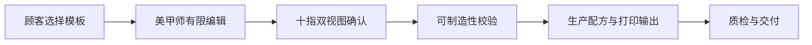

# Studio 模板库：产品备忘录与行动方案

> 日期：2026-07-24  
> 范围：扫描 + 打印软硬件系统中的 Studio Web 应用；覆盖选款、有限编辑、十指确认与可制造输出。

## 一句话决策

Studio 不应是由 AI 随机生成视觉元素的“美甲图库”，而应是一个以**可复用款式配方**为核心、连接“顾客选款 → 美甲师有限编辑 → 十指确认 → 可制造输出”的设计与确认系统。

首发以 3 个高确定性款式验证这一闭环：

1. **裸透猫眼金属流线**：日常主模板与走量款。
2. **Bridal 3D Floral French**：婚礼/约会/通勤的常青复购款。
3. **Mermaid Shell Pearl**：夏季传播与品牌识别款。

## 已达成的产品判断

### 市场与款式

- 主流并不偏向“越高、越复杂、越重”的 3D 结构；更有效的公式是：**舒适基底 + 可识别的轻结构件**。
- 中短杏仁、短椭圆、短方圆是主流佩戴与转化的基础；棺材、尖形承担部分高概念表达。
- 3D 打印的价值应集中在水滴、贝壳、花瓣、金属线导槽等高一致性结构模块，而非整片重型树脂甲。
- “不建议”的甲型搭配应提示专业风险，而不是硬禁止，保留美甲师与顾客的选择权。

### Studio 的角色

Studio 的价值不是替代美甲师创作，而是让审美选择和生产输出共享同一份数据：



## 最终信息架构

不要将“一个款式 × 一个甲型 × 一个长度”固化为大量 PNG。PNG 是确认或生产时导出的结果；源资产应为可编辑、可版本化的组件与配方。

```text
material-library/
├── shapes/                 # 甲型 + 长度轮廓 SVG、尺寸与贴合参数
├── components/             # 可复用 2D / 低浮雕视觉组件
│   ├── surfaces/           # jelly、cat-eye、pearl、chrome
│   ├── lines/              # 金属流线、法式边
│   ├── relief/             # 水滴、花瓣、贝壳、鱼鳞
│   └── ornaments/          # 珍珠、金珠、星月等
├── templates/              # 前台展示卡：名称、标签、缩略图、兼容性
├── recipes/                # 十指图层、锚点、颜色、尺寸与可编辑参数
├── production-profiles/    # 薄透、贴合、高精细装饰等工艺限制
└── generated/              # 临时预览、顾客确认版本、生产导出物
```

### 四类核心对象

| 对象 | 面向谁 | 作用 |
|---|---|---|
| Template | 顾客、美甲师 | 被选择的款式卡与筛选标签 |
| Component | 设计师、Studio | 可复用的视觉/结构元素 |
| Design Recipe | Studio、设计师 | 十指的图层、位置、颜色、可编辑范围 |
| Production Profile | 生产、质检 | 材料、厚度、结构高度、贴合与打印约束 |

必须区分 `Design Recipe` 与 `Production Profile`：前者决定“看起来怎样”，后者决定“能否稳定做出来”。

## 甲型与长度策略

正式产品不应只提供 4 种甲型、2 档长度；但也不应建立机械的全组合矩阵。

### 首发资产上限

- 6 个甲型家族：短方圆、短椭圆、杏仁、棺材/芭蕾、长杏仁、尖形。
- 长度：短、中、长。
- 以“可用组合”呈现，而不是强制 18 格全覆盖；首发目标为 **12 个有效组合**。

建议首发组合：

| 甲型 | 长度 |
|---|---|
| 方圆 | 短、中 |
| 椭圆 | 短、中 |
| 杏仁 | 短、中、长 |
| 棺材 | 中、长 |
| 长杏仁 | 中、长 |
| 尖形 | 中、长 |

模板针对每个组合记录 `recommended / available / not_recommended` 与理由。每款只支持真正适合的 6–9 个组合即可。

## 首发 Top 3 的素材与工艺边界

| 款式 | Studio 角色 | 核心组件 | 优先甲型长度 | 制造约束 |
|---|---|---|---|---|
| 裸透猫眼金属流线 | 日常主模板 / 走量 | jelly 底、猫眼光带、金属曲线、水滴 | 短椭圆、短/中/长杏仁、棺材 | 水滴最高约 1mm；金属线不跨越高摩擦切缘 |
| Bridal 3D Floral French | 常青复购 | 法式边、五瓣花、花心、金线、轻闪 | 短方圆、短椭圆、短/中杏仁 | 花瓣低于约 0.7mm；花心避开摩擦区 |
| Mermaid Shell Pearl | 传播与品牌记忆 | 珠光渐变、贝壳、鱼鳞、气泡、半珠 | 短椭圆、短/中/长杏仁、中棺材 | 轻量化；避免尖锐和易勾发结构 |

## 2D 素材 Demo Build

### Demo 目标

在不制作海量静态图的前提下，证明以下体验：

1. 顾客选款后可以看见与甲型/长度一致的十指效果；
2. 美甲师可在边界内完成换色、调整效果和局部组件；
3. 系统可给出可制造提示，并输出冻结的确认版本。

### 素材最小包

| 层 | 数量 | 内容 |
|---|---:|---|
| 甲体 SVG | 12 | 每个有效甲型长度组合一份标准轮廓与 UV/锚点空间 |
| 表面材质 | 12 | 裸粉、奶白、海盐灰、海蓝、薰衣草、银灰，以及 jelly/pearl/chrome 效果 |
| 组件 | 20 左右 | 金属线、法式边、水滴、五瓣花、花心、贝壳、鱼鳞、气泡、半珠等 |
| 款式配方 | 3 | 每款记录十指角色、层级、默认参数、允许编辑项 |
| 最终缩略图 | 约 20–30 | 模板卡和常用甲型的预计算缩略图；不是每指单独存图 |

### 画布编辑边界

首发只开放安全且可制造的参数：

- 底色、渐变、猫眼方向、金银线颜色；
- 法式边宽度；
- 水滴/花朵/珍珠的预设位置、密度和大小档位；
- 可选的“少 / 标准 / 丰富”装饰密度。

首发不开放自由手绘、任意上传贴图、无限旋转/缩放；这些功能会显著增加品控与制造风险。

## 渲染与后端方案

### 前后端职责

| 场景 | 实现位置 | 原因 |
|---|---|---|
| 画布拖动、换色、调整参数 | 前端 SVG/Canvas | 必须即时响应 |
| 模板卡缩略图 | 静态预生成 + CDN | 低成本快速加载 |
| 十指确认卡、分享、生产导出 | 后端权威渲染 | 保证一致、留存可追溯 |
| 可制造性校验 | 后端服务 | 统一执行厚度、位置、结构等规则 |

后端可使用 SVG 渲染器（resvg/Cairo）+ 图像合成库生成确认 PNG。不要为每次 Canvas 微调调用服务器渲染。

### 版本与缓存

- 临时预览缓存：5 分钟即可。
- 顾客确认后：永久保存 `recipe version + asset version + shape-length + scan profile + 用户覆盖参数 + renderer version`。
- 模板或组件更新不应覆盖已确认订单的视觉与生产记录。

## 行动方案

### Phase 0：本周——产品与数据边界定稿

| 行动 | 产出 | 验收标准 |
|---|---|---|
| 冻结 Top 3 与 12 个甲型长度组合 | `style-compatibility-matrix.json` | 每一组合都有推荐等级和理由 |
| 定义 Template / Component / Recipe / Production Profile 的 JSON Schema | 四份 schema | 能描述任一 Top 3 款式的十指设计与工艺限制 |
| 定义编辑白名单与不可制造规则 | `editing-policy.md` | 每个可编辑参数有范围、默认值与风险提示 |

### Phase 1：两周——真实素材与模板选择

| 行动 | 产出 | 验收标准 |
|---|---|---|
| 制作 12 个甲型长度 SVG | `shapes/` | 轮廓、viewBox、锚点空间一致 |
| 制作 20 个基础组件与 12 个材质 | `components/` | 组件可跨款式复用、可替换颜色 |
| 建立 Top 3 Recipe | `recipes/` | 每款可在至少 6 个兼容组合中正确渲染 |
| 建立模板卡与兼容排序 | `templates/` | 选甲型后推荐/不建议排序正确 |

### Phase 2：两周——确认闭环

| 行动 | 产出 | 验收标准 |
|---|---|---|
| 实现模板选择与有限画布编辑 | Web Demo | 颜色、效果、组件密度/位置可编辑 |
| 实现十指 Back/Palm 确认卡 | 确认页 + PNG 导出 | 同一配方在前端与导出图一致 |
| 接入生产规则校验 | 风险提示 | 高度、边缘、甲型不适配能被明确提示 |

### Phase 3：验证后扩展

| 行动 | 触发条件 | 方向 |
|---|---|---|
| 扩展至 10 套模板 | Top 3 有明确使用/确认数据 | 加入 Korean jelly、Coquette、Y2K、Chrome 等 |
| 扩展组件库 | 编辑需求集中在某一元素 | 新增主题组件而不是复制整套 PNG |
| 接入扫描数据 | 标准甲型预览稳定 | 用单指真实尺寸、弧度与贴合参数替换标准尺寸 |
| 接入打印工艺映射 | 生产校验稳定 | 让确认配方生成制造参数与打印任务 |

## 成功指标与风险

### 首发成功指标

- 美甲师可在 3 分钟内从模板完成一份十指确认卡；
- 顾客无需解释即可理解推荐、不建议和风险提示；
- Top 3 每款至少可稳定渲染 6 个兼容组合；
- 已确认预览与生产导出版本可追溯且一致；
- 新增一个款式时，以新增 Recipe 与少量组件为主，而不是制作数十张 PNG。

### 主要风险与对应动作

| 风险 | 处理 |
|---|---|
| 图案在不同甲型/长度上失衡 | 为兼容组合制作独立 SVG/参数版本，不用简单拉伸 |
| Canvas 开放过度导致无法生产 | 只开放白名单参数，并在提交时进行工艺校验 |
| 3D 元素过高、重、易勾发 | 将结构高度、边缘距离和密度写入 Production Profile |
| 模板更新影响历史订单 | 确认版本永久冻结，所有素材与 Recipe 均版本化 |
| 素材库膨胀 | 优先增加可重组组件和配方，最后才新增整套样式图 |

## 当前需要确认的三个决策

1. 首发是否锁定为上述 Top 3 与 12 个甲型长度组合？
2. 是否接受“有限画布编辑”作为首发边界，而不做自由绘图？
3. 是否以 `Recipe + Production Profile` 作为 Studio 与打印系统之间的正式接口？

