# Mercury Dew · M4 Contact Sheet（人工视觉签收）

本页汇总 Canonical Renderer 生成的真实 fixture 输出。

**M4-B 已完成：六项全部 `approved`**（签收人 Henry MacBook（workspace owner），2026-07-31，`manual-visual`）。
仍是 2.5D 模拟效果，制造状态 `unvalidated`；重新生成产物会作废签收并重置为 `pending_visual_signoff`。

`lengthPreset` = 产品侧长度；`geometryLength` = 轮廓文件长度。映射：`natural → short`，`medium → long`。

Renderer：`svg-2.5d/mercury-1` · Definition checksum：`fnv1a:25bc1799` · 制造状态：`unvalidated`

## 签收清单（与 SIGNOFF_TEMPLATE 对齐）

每组请核对：

1. Cat-eye 光带方向和宽度
2. Chrome Ribbon 是否贴合甲型且不越界
3. Droplet 是否具备透明主体、边缘暗部、折射高光和接触阴影
4. Almond / Oval / Coffin 比例是否自然
5. 十指重音指是否明显但不过载
6. 单甲、十指、顾客展示、PNG 是否一致
7. `lengthPreset` 与 `geometryLength` 是否正确映射

六项均已按上述清单核对并记录为 `approved`。Gallery `CONCEPT → SIMULATED` 已解锁但尚未执行——需先补 `asset_status` 的 `SIMULATED` 取值并同步 `tools/validate-assets.py` 的模板计数常量。

---

## almond-natural

- shape=`almond` · lengthPreset=`natural` · geometryLength=`short`
- [ ] 通过视觉签收

| 单甲 preview | 十指 tiled |
|---|---|
| 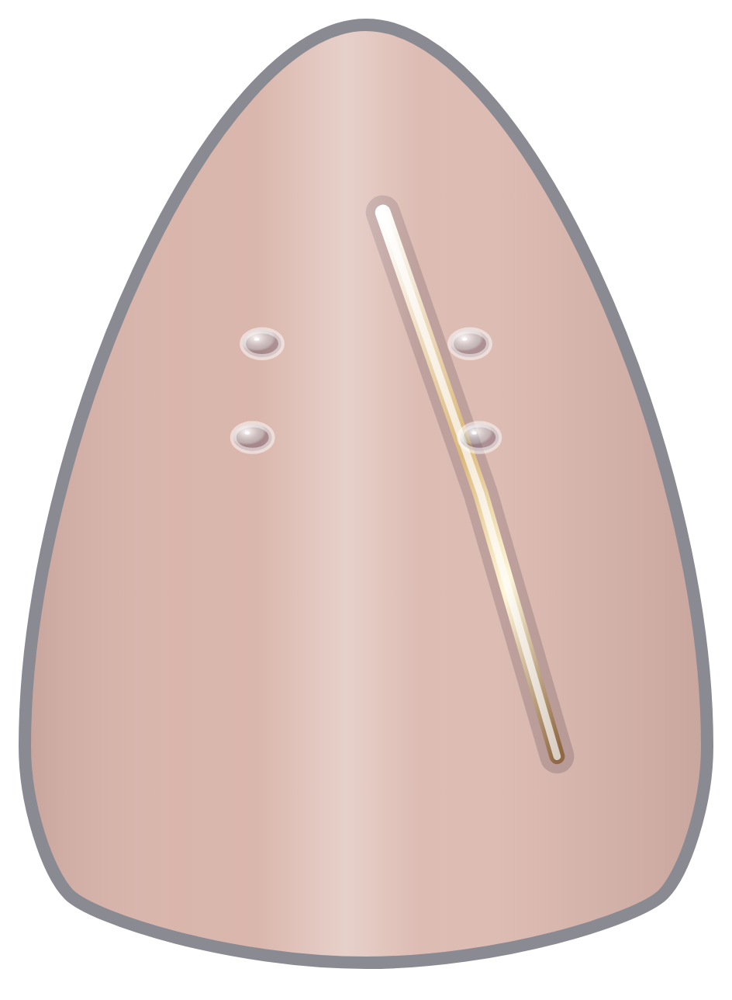 | 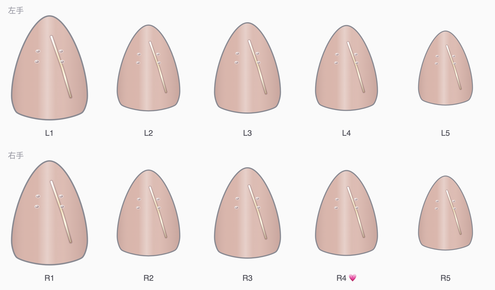 |

路径：`fixtures/almond-natural/{recipe.json,single.svg,tiled.svg,preview.png,tiled.png,snapshot.json}`

---

## almond-medium

- shape=`almond` · lengthPreset=`medium` · geometryLength=`long`
- [ ] 通过视觉签收

| 单甲 preview | 十指 tiled |
|---|---|
| 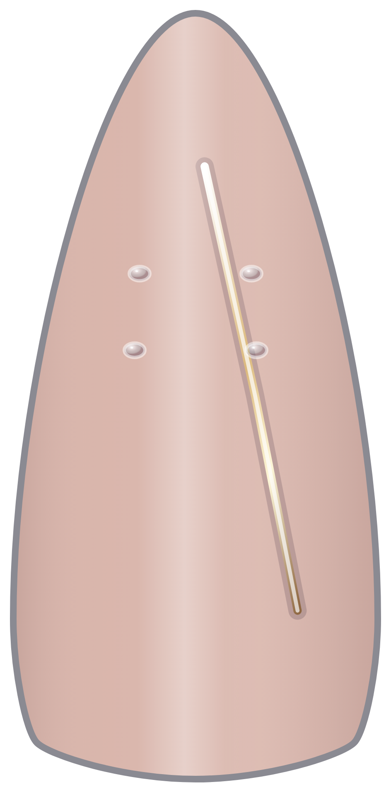 | 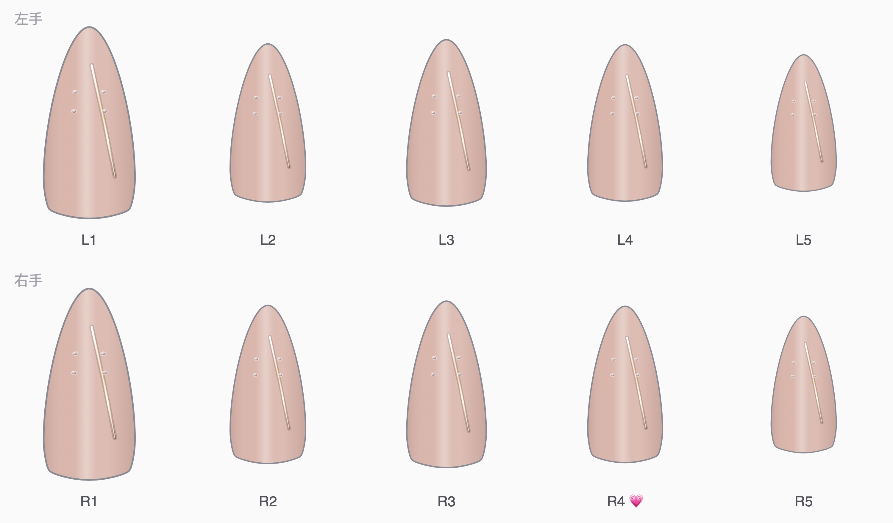 |

路径：`fixtures/almond-medium/{recipe.json,single.svg,tiled.svg,preview.png,tiled.png,snapshot.json}`

---

## oval-natural

- shape=`oval` · lengthPreset=`natural` · geometryLength=`short`
- [ ] 通过视觉签收

| 单甲 preview | 十指 tiled |
|---|---|
| 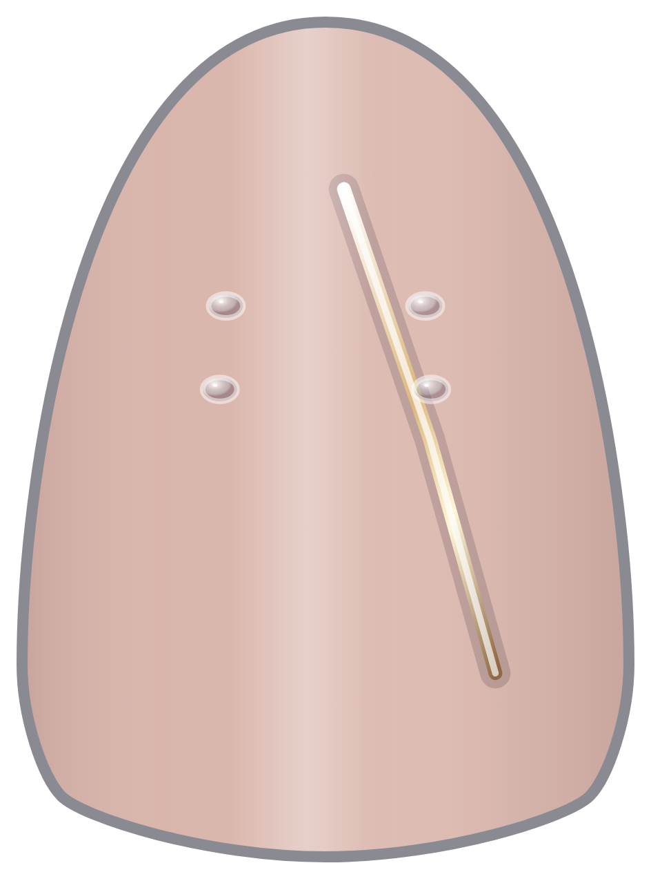 | 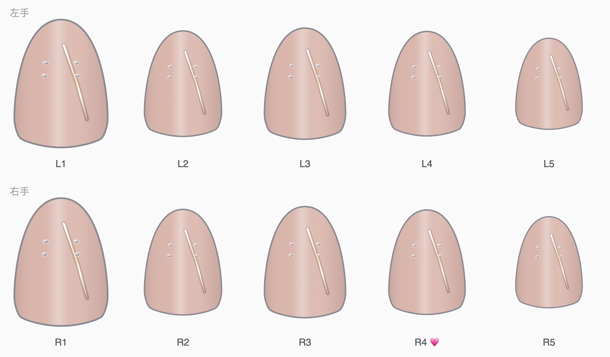 |

路径：`fixtures/oval-natural/{recipe.json,single.svg,tiled.svg,preview.png,tiled.png,snapshot.json}`

---

## oval-medium

- shape=`oval` · lengthPreset=`medium` · geometryLength=`long`
- [ ] 通过视觉签收

| 单甲 preview | 十指 tiled |
|---|---|
| 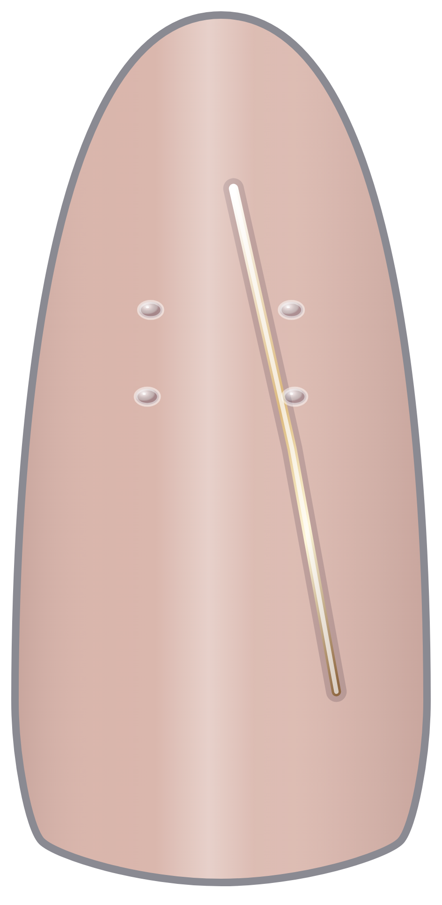 | 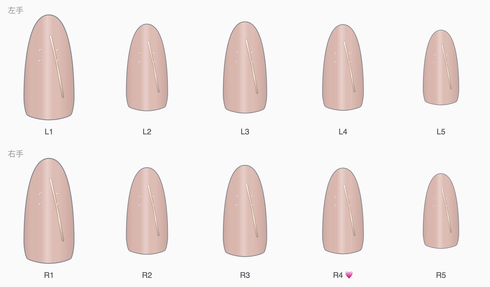 |

路径：`fixtures/oval-medium/{recipe.json,single.svg,tiled.svg,preview.png,tiled.png,snapshot.json}`

---

## coffin-natural

- shape=`coffin` · lengthPreset=`natural` · geometryLength=`short`
- [ ] 通过视觉签收

| 单甲 preview | 十指 tiled |
|---|---|
| 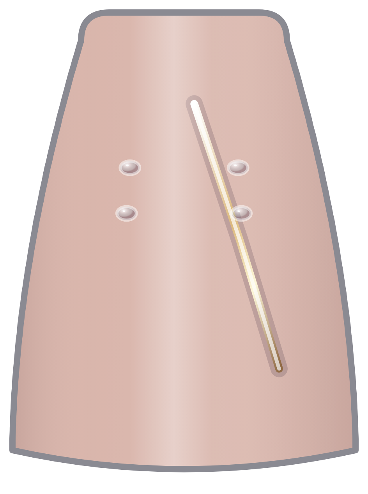 | 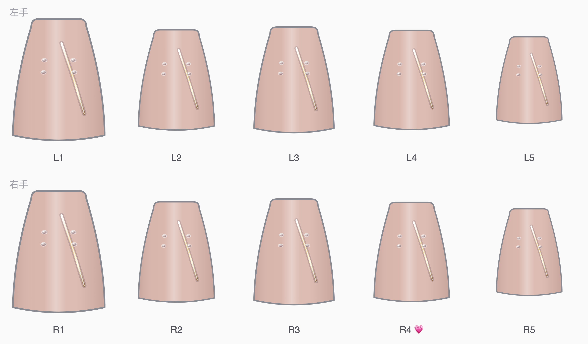 |

路径：`fixtures/coffin-natural/{recipe.json,single.svg,tiled.svg,preview.png,tiled.png,snapshot.json}`

---

## coffin-medium

- shape=`coffin` · lengthPreset=`medium` · geometryLength=`long`
- [ ] 通过视觉签收

| 单甲 preview | 十指 tiled |
|---|---|
| 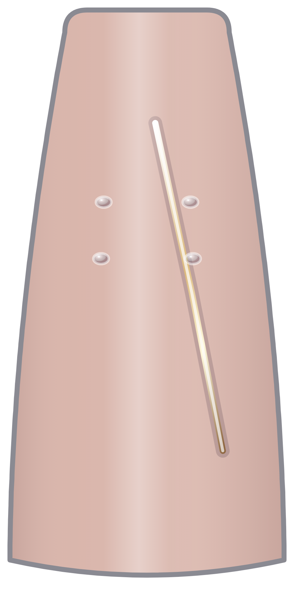 | 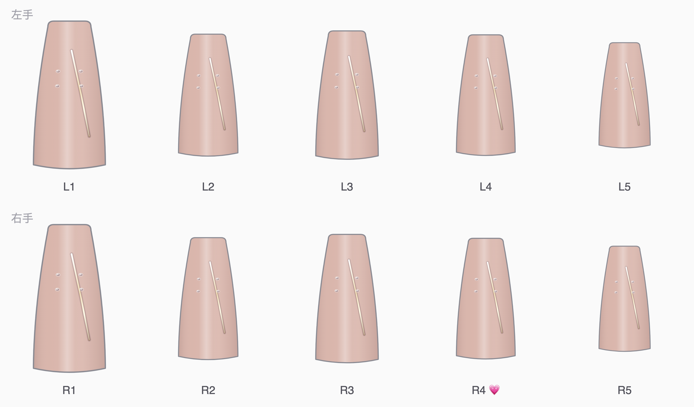 |

路径：`fixtures/coffin-medium/{recipe.json,single.svg,tiled.svg,preview.png,tiled.png,snapshot.json}`

---

## 自查备注（不代替人工签收）

- Cat-eye magnetic beam 在 Signature 默认参数下偏柔和，部分甲型上不如 Ribbon/Droplet 醒目；签收时请对照单甲 SVG 的 `magnetic_beam` 组确认方向约 8°。
- Chrome Ribbon（香槟金斜带）与 4 颗 Clear Droplet 在六组单甲中均可见；请确认不越界、折射高光与接触阴影是否足够。
- 当前 Signature 实例未设置 `fingerOverrides`，十指外观一致；「重音指」若产品要求差异化，需在签收后另开参数任务，而不是在本轮把状态升为 approved。
- 部分甲型的 beam `gradientTransform` 会出现 `7.105427357601002e-15` 浮点残留（应为 0）；可渲染且确定性重现，本轮不改 renderer，以免全量 checksum 变动。
- 制造状态保持 `unvalidated`；不得输出 STL / 3MF / 点胶路径 / 设备命令。
