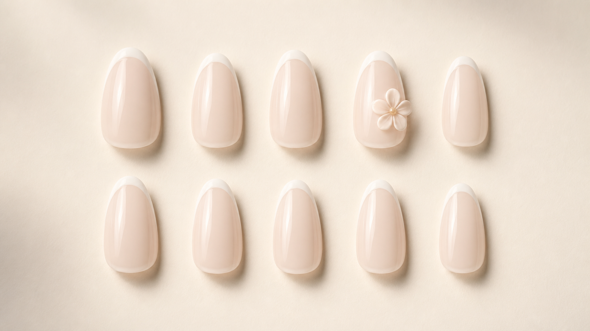
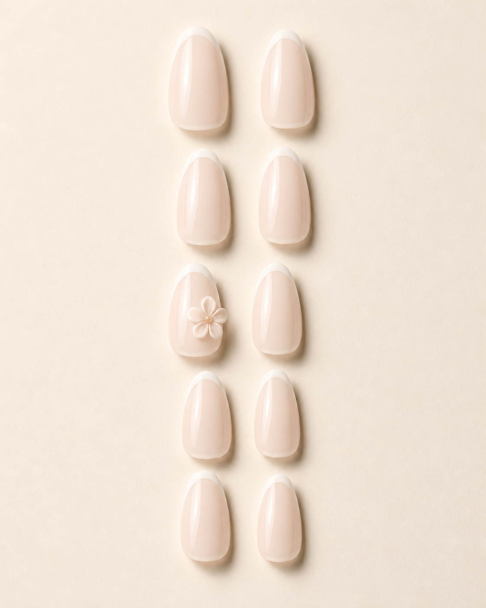
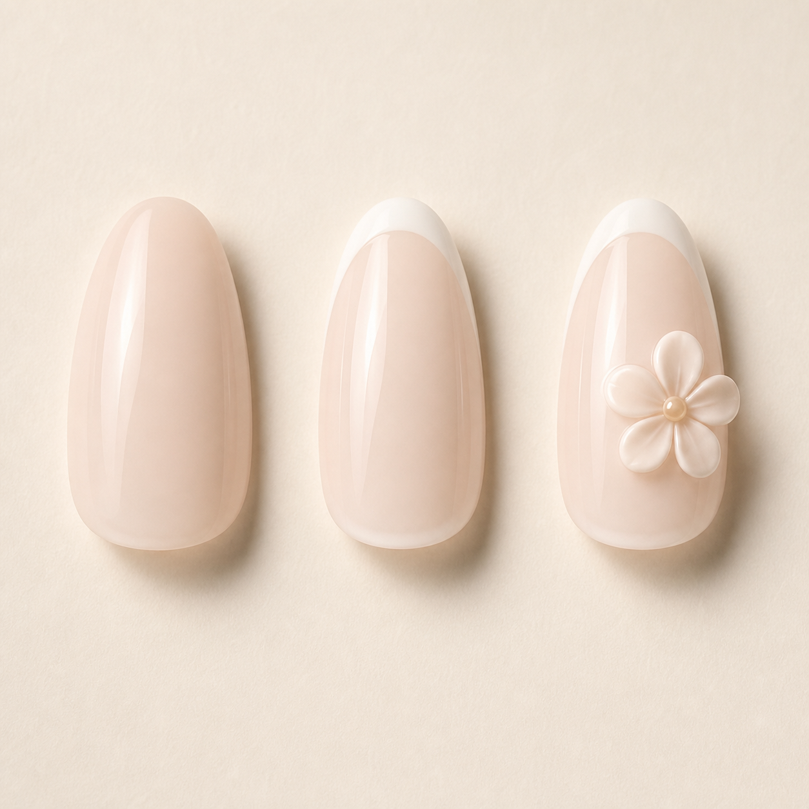
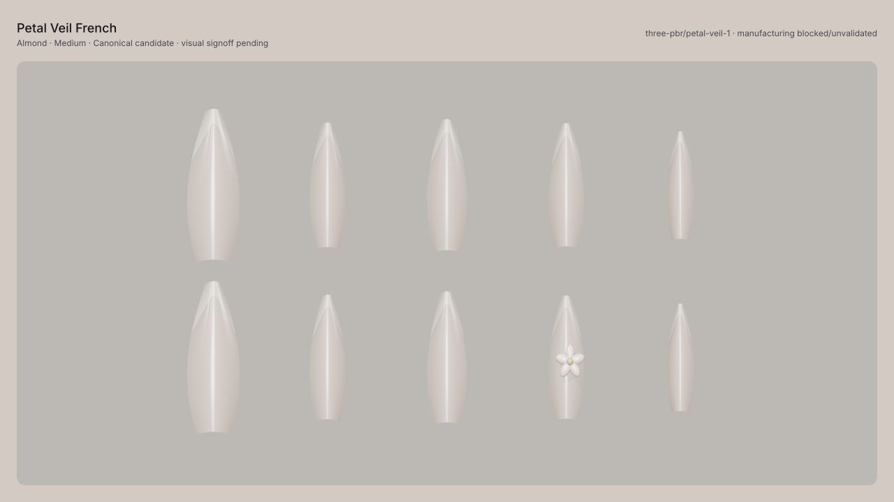
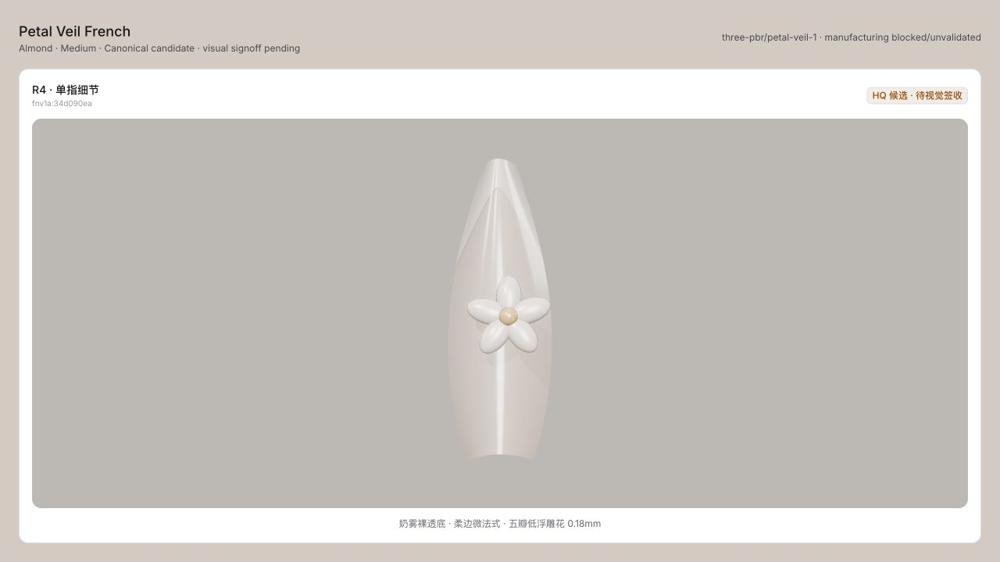
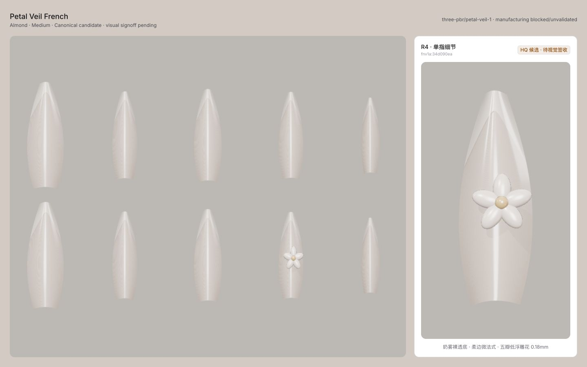

# Petal Veil French P0 · Concept / Canonical Contact Sheet

状态：`pending_visual_signoff`  
规格：`Almond × Medium`  
边界：Canonical Renderer 候选，不代表可制造。

## Concept direction

| 16:9 cover | 4:5 editorial |
|---|---|
|  |  |

| 16:9 editorial | Material progression |
|---|---|
|  |  |

## Canonical Renderer candidate

| 十指平铺 · 1280×720 | R4 单指 · 1280×720 |
|---|---|
|  |  |

### Presentation · 1440×900

## 人工核对重点

- 奶雾透明感与 Concept 方向是否一致。
- 微法式比例是否过深或过白。
- 花瓣厚度、接触阴影与甲面曲率是否自然。
- R4 是否是唯一重音指。
- tiled / single / Presentation 的层级和材质是否一致。

任何一项未通过，都保持 `CONCEPT`；不得把本文件的存在视为签收。
