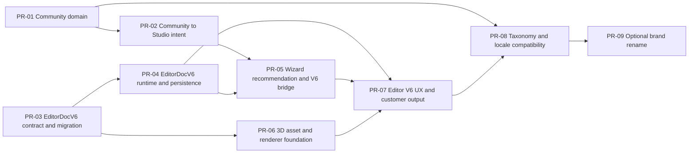

# Community-first / EditorDocV6 integration plan

Status: integration planning baseline

- Base branch: `main`
- Base commit: `f97daf01113759c5d64445cf10c497bd5c38972c`
- Integration branch: `integration/community-first-v6`
- Cursor source branch: `exp/cursor-studio-mvp`
- Cursor source head reviewed: `c555361160d1db2d2b6dbe4ec86bd70dd81346ed`
- Merge policy: do not merge or cherry-pick the Cursor branch wholesale. Rebuild bounded PRs against the latest accepted integration head.

## Architecture decision

Community is the first product domain to land. The Community UI, content repository, taxonomy, trust badges, and routing must be usable without importing Wizard or Editor stores.

The Cursor branch's editor line is not a valid version boundary: the public type is named `EditorDocV4`, while the stored literal is already `schemaVersion: 5`. Main still uses `schemaVersion: 3`. Integration must not perpetuate that gap. The next editor contract is one explicit `EditorDocV6`, with one repository API and migration support for v1-v5.

Rules:

1. `EditorDocV6` is the only new write format.
2. Reading legacy documents is pure and must not write to storage.
3. v1-v3 migrate directly to v6; v4 migrates through a tested legacy adapter; v5 migrates to v6.
4. Unknown future versions return an explicit unsupported result and are never overwritten.
5. Community detects Studio conflicts through a version-neutral repository probe; it never imports an editor schema or store.
6. Wizard, Editor, design list, duplication, confirmation/new-version flows, export, and Community conflict detection use the same repository boundary.
7. Generated images and simulated 3D renders are preview evidence, not canonical manufacturing assets or physical validation.

## PR dependency graph

PR-01 and PR-02 are the first merge train. PR-03 may be developed after PR-01 is stable, but it must not overtake Community in integration. PR-06 may be developed after PR-03, yet it lands only after PR-05 unless it is entirely asset/tooling-only.

## Stage plan

### PR-01 — Community domain foundation

- Branch: `cursor/pr-01-community-domain`
- Target: `integration/community-first-v6`
- Reference commits: `57c19db`, `e024797`, `ce6ce3a`, `e8ef7f9`; Community-only parts of `84d748f` and `c555361`.
- Owns: peer-domain routing and shell, Community repository/types, published content, publisher/taxonomy contracts, Discover/Official/Creators pages, filters, badges, content cards, validated cover assets.
- Excludes: Studio import intent, Wizard changes, Editor files, default locale changes, brand rename, 3D renderer, `AGENTS.md`.
- Exit: Community works as an independent top-level domain and all content/taxonomy references validate.

### PR-02 — Community to Studio intent boundary

- Branch: `cursor/pr-02-community-studio-intent`
- Target: accepted PR-01 integration head.
- Reference commits: `3ccb147`, `0e32099`.
- Owns: expiring `StudioImportIntentV1`, content/asset-version validation, safe return path, explicit conflict handling, version-neutral `inspectEditorDoc`/`hasEditorDoc` probe, Wizard draft detection.
- Excludes: EditorDoc migration, automatic overwrite, bidirectional Wizard/Editor sync, editor UI, recommendation policy.
- Exit: Community publishes an intent; Studio is the sole consumer; expired, mismatched, inspiration-only, draft, frozen, and existing-editor states are deterministic.

### PR-03 — EditorDocV6 contract and migration

- Branch: `cursor/pr-03-editordoc-v6-contract`
- Target: accepted PR-02 integration head.
- Reference commits: data/model/migration portions of `369d516`, `11f5348`, `171d9e2`, `9b748dd`.
- Owns: `EditorDocV6`, legacy fixtures, pure v1-v5 migration, validation, version-neutral repository result types, stable ID policy, compatibility matrix.
- Excludes: `store-v4.ts`, V4 UI components, 3D runtime, broad visual changes.
- Exit: there is no new API named V4/V5; all supported legacy fixtures load to schema 6 without silent storage writes or data loss.

### PR-04 — EditorDocV6 runtime and persistence

- Branch: `cursor/pr-04-editordoc-v6-runtime`
- Target: accepted PR-03 integration head.
- Reference commits: runtime/store/history/autosave portions of `369d516`, `11f5348`, `171d9e2`, `9b748dd`.
- Owns: single v6 store/runtime, history, autosave, manual save/retry, reload recovery, duplication/versioning, read-only confirmation, summary/thumbnail/canvas projections.
- Excludes: final editor visual redesign, HQ 3D integration, taxonomy relabeling.
- Exit: all editor entry points and downstream readers operate through the v6 repository; no parallel v3/v5 writable stores remain.

### PR-05 — Wizard recommendation and V6 bridge

- Branch: `cursor/pr-05-wizard-v6-bridge`
- Target: accepted PR-04 integration head.
- Reference commits: `492de62`, Wizard portions of `0e32099`, `369d516`, `11f5348`, `84d748f`.
- Owns: canonical 2 curated + 1 concept recommendation rule, asset resolution, Community intent consumption, Wizard draft recovery, one-way Wizard-to-v6 bridge with explicit conflict behavior.
- Excludes: Editor-to-Wizard write-back, Community visual changes, 3D renderer.
- Exit: Community-to-Wizard-to-Editor creates a v6 document exactly once; refresh and conflict paths preserve user work.

### PR-06 — 3D asset and renderer foundation

- Branch: `cursor/pr-06-3d-foundation`
- Target: accepted PR-05 integration head.
- Reference commits: `3965f41`, `0895587`, renderer/geometry portions of `9b748dd`.
- Owns: vendor-neutral asset manifests, web GLB validation, shell/component coordinate contract, lazy renderer adapters, truthful simulated/render-ready status, build-time asset controls.
- Excludes: raw/internal production artifacts from the web bundle, vendor-specific manufacturing promises, broad Editor UI.
- Exit: assets validate, missing/corrupt files degrade safely, and renderer modules are lazy-loaded without increasing unrelated routes unnecessarily.

### PR-07 — Editor V6 UX and customer-ready output

- Branch: `cursor/pr-07-editor-v6-ux`
- Target: accepted PR-06 integration head.
- Reference commits: UI/interaction portions of `369d516`, `11f5348`, `171d9e2`, `9b748dd`, `4382901`.
- Owns: v6-native ten-nail layer studio, direct manipulation, geometry/finish source-of-truth, cross-finger actions, guide, 2D/3D preview intent, presentation, export, confirmation/new-version states, responsive professional layout.
- Excludes: brand rename and locale/taxonomy migration.
- Exit: automated gates plus manual state-transition and visual walkthrough pass. A green unit suite alone is not acceptance.

### PR-08 — Taxonomy and locale compatibility

- Branch: `cursor/pr-08-taxonomy-locale`
- Target: accepted PR-07 integration head.
- Reference commits: `c555361` only, split by concern.
- Owns: documented US nail-element taxonomy, stable machine IDs, centralized labels, aliases/migrations for any legacy IDs, English-default locale only if all routes remain switchable and stored data is locale-neutral.
- Excludes: Editor schema changes, brand rename, unrelated UI restyling.
- Exit: no user document breaks because of a label/ID rename; Community, Wizard, and Editor use the same label resolver.

### PR-09 — Optional brand rename

- Branch: `cursor/pr-09-brand-rename`
- Target: accepted PR-08 integration head.
- Reference commit: `cda554f`.
- Owns: visible product-name replacement only after product approval, plus metadata and schema examples where names are display text.
- Excludes: schema identifiers, storage keys, route paths, package names, taxonomy IDs unless an explicit compatibility migration exists.
- Exit: product owner approves the target name; old documents and deep links still open.

## Integration protocol

1. Cut each PR branch from the latest accepted integration head. Do not stack product changes on `exp/cursor-studio-mvp`.
2. Treat source commits as reference material. Use path-level transplant or rewrite; never cherry-pick a mixed commit unchanged.
3. One Cursor/Composer writer owns product code. Review and visual agents are read-only.
4. Each PR must include its own test scripts/fixtures. A later PR may extend an earlier test but may not delete its gate.
5. Merge to integration only after the PR-specific checklist and the common delivery standard pass.
6. After PR-07 and PR-08, run a full integration regression before proposing `integration/community-first-v6` to `main`.
7. `main` stays untouched until a final review explicitly approves the integration branch.

## Global final gate before proposing integration to main

- `git diff --check` passes.
- `npm run typecheck` passes.
- `npm run build:integration` passes.
- `npm run test:handdraw` passes.
- `npm run validate-assets` and `npm run validate-recipes` pass.
- All new Community, EditorDocV6, Wizard bridge, renderer, and taxonomy scripts pass.
- `npm run test:slots` is run and compared with the main baseline; do not alter signed Slot V2 data merely to remove the known `L3 rotationDeg 5.81 > 5` baseline result.
- Manual walkthrough covers Dashboard, Community, Wizard, Editor, confirmation/read-only, new-version, back/return, refresh recovery, export, and 3D fallback.
- Visual evidence includes 1280×720, 1440×900, and 390×844. No horizontal overflow, hidden primary CTA, blank screen, or repeating severe console error.
- The PR report separates implemented facts, simulated/prototype evidence, and unverified physical manufacturing claims.

## Cursor prompt index

- [PR-01 Community domain](./prompts/PR01_COMMUNITY_DOMAIN.md)
- [PR-02 Community to Studio intent](./prompts/PR02_COMMUNITY_STUDIO_INTENT.md)
- [PR-03 EditorDocV6 contract](./prompts/PR03_EDITORDOC_V6_CONTRACT.md)
- [PR-04 EditorDocV6 runtime](./prompts/PR04_EDITORDOC_V6_RUNTIME.md)
- [PR-05 Wizard V6 bridge](./prompts/PR05_WIZARD_V6_BRIDGE.md)
- [PR-06 3D foundation](./prompts/PR06_3D_FOUNDATION.md)
- [PR-07 Editor V6 UX](./prompts/PR07_EDITOR_V6_UX.md)
- [PR-08 Taxonomy and locale](./prompts/PR08_TAXONOMY_LOCALE.md)
- [PR-09 Optional brand rename](./prompts/PR09_OPTIONAL_BRAND_RENAME.md)
