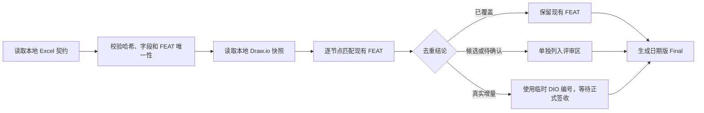

# NextGen Beauty 全域功能需求池 Final

> 已被 [[NextGen_Beauty_全域功能需求池_Final_2026-09-04]] 取代为现行本地需求合同；本页保留 2026-09-02 的 127 条/17 字段/81 节点历史快照，不改写原正文。

> 本文的 Final 表示 2026-09-02 本地快照已完成完整编目与 Draw.io 去重，不表示需求已批准、软件已实现或生产已验收。127 条正式功能均保持“待评审”。

## 版本更新记录

| 文档版本 | 更新日期 | 更新内容 | 确认状态 |
|---|---|---|---|
| 2026-09-02 | 2026-09-02 | 固定本地功能清单与 Draw.io 快照；完成 81 个图节点去重；生成全域 Final 需求池 | 待业务与技术评审 |

## 需求目标

建立一份不依赖云文档运行的全域功能目录：以本地 Excel 快照为正式需求契约，保留全部功能编号、状态、验收摘要、来源与门禁；Draw.io 只用于识别已覆盖内容和待评审候选。

## 交互与业务流程

本次更新不改变产品交互，只调整需求来源、去重和版本治理流程。

## 需求清单

### 基线概览

| 项目 | 数量或结论 |
|---|---|
| 正式功能 | 127 条；编号唯一 |
| 字段 | 17 个；完整值保存在本地标准化 JSON |
| 状态 | 待评审 127 |
| 优先级 | P0 63, P1 53, P2 11 |
| Draw.io 节点 | 81 个有文字节点，全部完成分类 |
| 去重结论 | covered 58；candidate 15；pending 8；increment 0；conflict 0 |

### 模块分布

| 需求模块 | 功能数 |
|---|---:|
| 设备接入与管理 | 11 |
| Studio设计与版本 | 17 |
| 工单与设备生产 | 9 |
| 质量、交付与追溯 | 8 |
| 扫描与甲面数据 | 10 |
| 异常、运维与恢复 | 8 |
| 制造准备与工艺 | 12 |
| 测试验收与可观测 | 11 |
| 账号、门店与顾客 | 8 |
| AI辅助与算法研究 | 5 |
| 社区内容与选款 | 12 |
| 三维预览与交互 | 16 |

### 牵头侧分布

| 牵头侧 | 功能数 |
|---|---:|
| MES后端 | 32 |
| P端后端 | 29 |
| Web前端 | 22 |
| 算法 | 17 |
| 资深3D前端开发 | 16 |
| 测试 | 7 |
| 嵌入式 | 4 |

## 本地契约与来源边界

- 正式契约：[需求模块与功能清单_2026-09-02.xlsx](源文件/需求模块与功能清单_2026-09-02.xlsx)，SHA-256：<code>e256a315717d4fa041b27300f68a78e5bf9789f859d23d32f910b253bc046dd0</code>。
- 无损字段快照：[需求模块与功能清单_2026-09-02.normalized.json](源文件/需求模块与功能清单_2026-09-02.normalized.json)，包含 127 条记录与 17 个字段。
- Draw.io 输入：[软件架构图V1.0.3.drawio](源文件/软件架构图V1.0.3.drawio)，SHA-256：<code>1fb66747028011552ce1052af0748b95eb379279e6f3c2619c89779bcbc32f4e</code>。
- 钉钉 URL 只保存在来源清单中用于追溯；本文、去重账本和 Skill 的普通运行不访问钉钉。
- Vault 文档用于验证来源、冲突和证据边界，不替换本地功能清单。

## Draw.io 去重裁决

完整的 81 条节点映射见 [NextGen_Beauty_Drawio_需求去重映射_2026-09-02.json](NextGen_Beauty_Drawio_需求去重映射_2026-09-02.json)。本轮没有可直接升级为正式 FEAT 的高置信度独立增量，也没有发现需要覆盖本地契约的冲突。

### 候选输入

| DIO 编号 | Draw.io 节点 | 邻近 FEAT | 保留为候选的原因 |
|---|---|---|---|
| DIO-003 | 用户形态2： 设备使用人 <code>AjI5ajCrkQR87gol3wgJ-3</code> | FEAT-0101, FEAT-0109 | 设备使用人角色未形成独立 FEAT，权限边界待定义。 |
| DIO-005 | 设备使用视频分享【tbd】 <code>AjI5ajCrkQR87gol3wgJ-22</code> | FEAT-0220 | 节点标记 tbd，公开关联、版权和隐私边界未确定。 |
| DIO-008 | 关注【tbd】 <code>AjI5ajCrkQR87gol3wgJ-30</code> | FEAT-0209, FEAT-0210 | 关注关系标记 tbd，缺少社交关系和通知语义。 |
| DIO-011 | 通知（Q&A、contact、消息...） <code>AjI5ajCrkQR87gol3wgJ-33</code> | FEAT-0201, FEAT-0222 | 通知中心未形成独立契约，Q&A、联系和消息范围待确认。 |
| DIO-017 | A05. 业务 / 经营数据【tbd】 <code>AjI5ajCrkQR87gol3wgJ-38</code> | FEAT-0222 | 标记 tbd，缺少数据模型、Owner 和验收口径。 |
| DIO-020 | C02. 快速模型数据（手机照片测量） <code>AjI5ajCrkQR87gol3wgJ-49</code> | FEAT-0401, FEAT-0402 | 可映射快速采集，但不能作为已验证制造输入。 |
| DIO-021 | C02. 快速模型数据（手动输入尺寸） <code>AjI5ajCrkQR87gol3wgJ-153</code> | FEAT-0402 | 手动尺寸属于候选快速路径，验收边界未定义。 |
| DIO-023 | C04. 手指（长度、肤色）信息【tbd】 <code>AjI5ajCrkQR87gol3wgJ-42</code> | FEAT-0415, FEAT-0315 | 标记 tbd，涉及手部感知和虚拟试戴候选。 |
| DIO-031 | B06. 沟通 / 业务流程状态【tbd】 <code>AjI5ajCrkQR87gol3wgJ-145</code> | FEAT-0107, FEAT-0222 | 标记 tbd，缺少统一沟通/业务状态机。 |
| DIO-032 | B07. 偏好记录、标签数据【tbd】 <code>AjI5ajCrkQR87gol3wgJ-46</code> | FEAT-0211, FEAT-0414 | 偏好和标签语义未定，仅存在邻近候选功能。 |
| DIO-033 | AIGC <code>AjI5ajCrkQR87gol3wgJ-105</code> | FEAT-0413, FEAT-0416 | 宽泛研究标签，尚未形成可验收 AI 功能。 |
| DIO-039 | D012. 甲型库（特效款） <code>AjI5ajCrkQR87gol3wgJ-82</code> | FEAT-0207, FEAT-0404 | 特效甲型库未单独定义来源、资格和验收。 |
| DIO-053 | 交互（AR试戴）【tbd】 <code>AjI5ajCrkQR87gol3wgJ-75</code> | FEAT-0315, FEAT-0415 | 明确标记 tbd，属于手部感知/虚拟试戴候选。 |
| DIO-068 | 外部导入图片后的工序拆分（参考图） <code>Ck6FdHnIqsOK2ZLSTPjp-9</code> | FEAT-0207, FEAT-0413 | 参考图导入已有邻近能力，但自动工序拆分更具体且未形成契约。 |
| DIO-069 | 文 / 图 / 草绘 生图 <code>Ck6FdHnIqsOK2ZLSTPjp-11</code> | FEAT-0413, FEAT-0416 | 属于 AIGC 候选，缺少输入、输出和验收合同。 |

上述候选不进入正式 127 条功能目录。后续只有在主体、触发条件、业务规则、异常和验收结果明确后，才能申请正式 FEAT 编号。

### 待确认的架构标签

| DIO 编号 | Draw.io 节点 | 待确认原因 |
|---|---|---|
| DIO-012 | A0. P端用户信息数据库 <code>AjI5ajCrkQR87gol3wgJ-35</code> | 数据库分组标题，不是独立可验收功能。 |
| DIO-018 | C0. 指甲数据库 <code>AjI5ajCrkQR87gol3wgJ-39</code> | 数据库分组标题，不是独立可验收功能。 |
| DIO-024 | - P端用户定义为，使用我们软件系统的人，不区分B端和C端。在本项目语境中，P端用户简称“用户” - C端用户定义为，佩戴穿戴甲的人。在本项目语境中，C端用户称为“C端用户” <code>AjI5ajCrkQR87gol3wgJ-43</code> | 角色定义说明，不是功能契约。 |
| DIO-025 | B0. C端用户信息数据库 <code>AjI5ajCrkQR87gol3wgJ-44</code> | 数据库分组标题，不是独立可验收功能。 |
| DIO-034 | G0. 灵感数据库 <code>AjI5ajCrkQR87gol3wgJ-54</code> | 数据库分组标题，不是独立可验收功能。 |
| DIO-037 | D0. 设计资产数据库 <code>AjI5ajCrkQR87gol3wgJ-59</code> | 数据库分组标题，不是独立可验收功能。 |
| DIO-043 | E0. 设计方案数据库 <code>AjI5ajCrkQR87gol3wgJ-64</code> | 数据库分组标题，不是独立可验收功能。 |
| DIO-048 | F0. 生产数据库 <code>AjI5ajCrkQR87gol3wgJ-71</code> | 数据库分组标题，不是独立可验收功能。 |

### 图内重复项

- 两个“TP01：可制造性检查”节点均归并到 FEAT-0407。
- 两个“TP02：智能排产”节点均归并到 FEAT-0031。
- 图中的制造、工单、监控、耗材和排产节点只覆盖 FEAT-0013～0032 的部分内容；该编号段的直接来源仍是本地功能清单所列文档。

## MES FEAT-0013～0032 来源说明

| ID | 功能名称 | 文档定位 | 原始来源 |
|---|---|---|---|
| FEAT-0013 | 编排机器工序和人工步骤，形成可执行工艺路线 | NextGen_Beauty_MES_Backend_Requirements_v1_2026-08-31.md · FEAT-0013｜工艺路线与人工工序管理 | /Users/henry.macbook/iCloud云盘（归档）/Desktop/nextGen-Beauty/工作记录_2026-W36_08-31至09-06/UJ-04_MES生产操作与质检履约_2026-08-31.md#2. 起点、终点与前置条件 /Users/henry.macbook/iCloud云盘（归档）/Desktop/nextGen-Beauty/工作记录_2026-08-07/V7_系统架构/V7_设备协议与Vendor_Adapter架构.md#9. 状态模型 |
| FEAT-0014 | 检查材料、设备和工位资源，并防止重复占用 | NextGen_Beauty_MES_Backend_Requirements_v1_2026-08-31.md · FEAT-0014｜制造资源校验与互斥占用 | /Users/henry.macbook/iCloud云盘（归档）/Desktop/nextGen-Beauty/工作记录_2026-08-07/V7_系统架构/V7_系统架构与领域合同.md#4.6 Resource & Workcell Digital Twin /Users/henry.macbook/iCloud云盘（归档）/Desktop/nextGen-Beauty/工作记录_2026-08-07/V7_系统架构/V7_设备协议与Vendor_Adapter架构.md#13. 资源锁与材料解析 |
| FEAT-0015 | 创建生产工单并安排每一步的执行计划 | NextGen_Beauty_MES_Backend_Requirements_v1_2026-08-31.md · FEAT-0015｜生产工单与执行计划 | /Users/henry.macbook/iCloud云盘（归档）/Desktop/nextGen-Beauty/工作记录_2026-08-07/V7_系统架构/V7_设备协议与Vendor_Adapter架构.md#5. 任务与执行分层 /Users/henry.macbook/iCloud云盘（归档）/Desktop/nextGen-Beauty/工作记录_2026-W36_08-31至09-06/UJ-04_MES生产操作与质检履约_2026-08-31.md#3. 主旅程 |
| FEAT-0016 | 为每次设备执行建立独立任务，避免新旧结果混淆 | NextGen_Beauty_MES_Backend_Requirements_v1_2026-08-31.md · FEAT-0016｜设备任务与执行尝试隔离 | /Users/henry.macbook/iCloud云盘（归档）/Desktop/nextGen-Beauty/工作记录_2026-08-07/V7_系统架构/V7_系统架构与领域合同.md#4.8 Production Planning & Execution /Users/henry.macbook/iCloud云盘（归档）/Desktop/nextGen-Beauty/工作记录_2026-08-07/V7_系统架构/V7_设备协议与Vendor_Adapter架构.md#5. 任务与执行分层 |
| FEAT-0017 | 下发设备任务前检查条件，满足后才允许开工 | NextGen_Beauty_MES_Backend_Requirements_v1_2026-08-31.md · FEAT-0017｜执行下发与开工门禁 | /Users/henry.macbook/iCloud云盘（归档）/Desktop/nextGen-Beauty/工作记录_2026-08-07/V7_系统架构/V7_设备协议与Vendor_Adapter架构.md#8. Canonical 命令 /Users/henry.macbook/iCloud云盘（归档）/Desktop/nextGen-Beauty/工作记录_2026-W36_08-31至09-06/UJ-04_MES生产操作与质检履约_2026-08-31.md#3. 主旅程 |
| FEAT-0018 | 汇总设备运行事件，更新门店看到的生产进度 | NextGen_Beauty_MES_Backend_Requirements_v1_2026-08-31.md · FEAT-0018｜运行事件与业务进度投影 | /Users/henry.macbook/iCloud云盘（归档）/Desktop/nextGen-Beauty/工作记录_2026-08-07/V7_系统架构/V7_设备协议与Vendor_Adapter架构.md#6. Canonical Message Envelope /Users/henry.macbook/iCloud云盘（归档）/Desktop/nextGen-Beauty/工作记录_2026-W36_08-31至09-06/UJ-04_MES生产操作与质检履约_2026-08-31.md#3. 主旅程 |
| FEAT-0019 | 设备超时或断线后重新连接，并核对断线期间结果 | NextGen_Beauty_MES_Backend_Requirements_v1_2026-08-31.md · FEAT-0019｜超时断线与重连对账 | /Users/henry.macbook/iCloud云盘（归档）/Desktop/nextGen-Beauty/工作记录_2026-08-07/V7_系统架构/V7_设备协议与Vendor_Adapter架构.md#14. 重连与恢复 /Users/henry.macbook/iCloud云盘（归档）/Desktop/nextGen-Beauty/工作记录_2026-W36_08-31至09-06/UJ-05_门店设备异常与运维恢复_2026-08-31.md#4. 关键失败与恢复 |
| FEAT-0020 | 处理生产取消和变更，并明确已执行部分如何处置 | NextGen_Beauty_MES_Backend_Requirements_v1_2026-08-31.md · FEAT-0020｜业务取消变更与执行处置 | /Users/henry.macbook/iCloud云盘（归档）/Desktop/nextGen-Beauty/工作记录_2026-W36_08-31至09-06/UJ-04_MES生产操作与质检履约_2026-08-31.md#4. 关键失败与恢复 |
| FEAT-0021 | 核对实际生产产物、使用材料和执行记录是否一致 | NextGen_Beauty_MES_Backend_Requirements_v1_2026-08-31.md · FEAT-0021｜实际产出与执行记录核对 | /Users/henry.macbook/iCloud云盘（归档）/Desktop/nextGen-Beauty/工作记录_2026-08-07/V7_系统架构/V7_系统架构与领域合同.md#4.10 Quality, Traceability, Maintenance & Safety /Users/henry.macbook/iCloud云盘（归档）/Desktop/nextGen-Beauty/工作记录_2026-W36_08-31至09-06/UJ-04_MES生产操作与质检履约_2026-08-31.md#3. 主旅程 |
| FEAT-0022 | 按每根手指检查成品质量，并隔离不合格结果 | NextGen_Beauty_MES_Backend_Requirements_v1_2026-08-31.md · FEAT-0022｜逐指质量检查与不合格隔离 | /Users/henry.macbook/iCloud云盘（归档）/Desktop/nextGen-Beauty/工作记录_2026-W36_08-31至09-06/UJ-04_MES生产操作与质检履约_2026-08-31.md#3. 主旅程 /Users/henry.macbook/iCloud云盘（归档）/Desktop/nextGen-Beauty/工作记录_2026-W36_08-31至09-06/UJ-04_MES生产操作与质检履约_2026-08-31.md#6. 验收清单（待验证） |
| FEAT-0023 | 发起补做或返工，并对新结果重新验收 | NextGen_Beauty_MES_Backend_Requirements_v1_2026-08-31.md · FEAT-0023｜补做返工与再次验收 | /Users/henry.macbook/iCloud云盘（归档）/Desktop/nextGen-Beauty/工作记录_2026-W36_08-31至09-06/UJ-04_MES生产操作与质检履约_2026-08-31.md#4. 关键失败与恢复 |
| FEAT-0024 | 向门店交接生产结果，并提供可追溯摘要 | NextGen_Beauty_MES_Backend_Requirements_v1_2026-08-31.md · FEAT-0024｜门店交接与追溯摘要 | /Users/henry.macbook/iCloud云盘（归档）/Desktop/nextGen-Beauty/工作记录_2026-W36_08-31至09-06/UJ-04_MES生产操作与质检履约_2026-08-31.md#3. 主旅程 /Users/henry.macbook/Desktop/nextGen-brief/协议和架构/NextGen_Beauty_System_Logic_Architecture_v3_2026-08-31.md#1. 布局与职责 |
| FEAT-0025 | 校验内部测试权限，并完整记录测试执行过程 | NextGen_Beauty_MES_Backend_Requirements_v1_2026-08-31.md · FEAT-0025｜内部测试授权校验与执行记录 | /Users/henry.macbook/iCloud云盘（归档）/Desktop/nextGen-Beauty/工作记录_2026-W36_08-31至09-06/UJ-01_P端开店初始化与首件测试_2026-08-31.md#两条测试路径不能互相替代 /Users/henry.macbook/iCloud云盘（归档）/Desktop/nextGen-Beauty/工作记录_2026-W36_08-31至09-06/UJ-04_MES生产操作与质检履约_2026-08-31.md#2. 起点、终点与前置条件 |
| FEAT-0026 | 分开生产操作和设备维护权限，并记录审计日志 | NextGen_Beauty_MES_Backend_Requirements_v1_2026-08-31.md · FEAT-0026｜生产及维护权限隔离与审计 | /Users/henry.macbook/iCloud云盘（归档）/Desktop/nextGen-Beauty/工作记录_2026-08-07/V7_系统架构/V7_系统架构与领域合同.md#5. 五个横切合同 /Users/henry.macbook/iCloud云盘（归档）/Desktop/nextGen-Beauty/工作记录_2026-08-07/V7_系统架构/V7_设备协议与Vendor_Adapter架构.md#15. 安全与维护 |
| FEAT-0027 | 用模拟设备复现故障，验证异常处理和恢复流程 | NextGen_Beauty_MES_Backend_Requirements_v1_2026-08-31.md · FEAT-0027｜设备模拟与故障回放 | /Users/henry.macbook/iCloud云盘（归档）/Desktop/nextGen-Beauty/工作记录_2026-08-07/V7_系统架构/V7_设备协议与Vendor_Adapter架构.md#16. Adapter Contract Test /Users/henry.macbook/iCloud云盘（归档）/Desktop/nextGen-Beauty/工作记录_2026-08-07/V7_系统架构/V7_设备协议与Vendor_Adapter架构.md#17. 当前差距与进入真实设备前门禁 |
| FEAT-0028 | 管理耗材更换、保养周期和到期提醒 | NextGen_Beauty_MES_Backend_Requirements_v1_2026-08-31.md · FEAT-0028｜耗材与周期维护计划 | /Users/henry.macbook/iCloud云盘（归档）/Desktop/nextGen-Beauty/工作记录_2026-08-07/V7_系统架构/V7_系统架构与领域合同.md#4.6 Resource & Workcell Digital Twin /Users/henry.macbook/iCloud云盘（归档）/Desktop/nextGen-Beauty/工作记录_2026-08-07/V7_系统架构/V7_系统架构与领域合同.md#4.10 Quality, Traceability, Maintenance & Safety |
| FEAT-0029 | 下发受控维护命令，并要求现场确认和留痕 | NextGen_Beauty_MES_Backend_Requirements_v1_2026-08-31.md · FEAT-0029｜受控维护命令与现场确认 | /Users/henry.macbook/iCloud云盘（归档）/Desktop/nextGen-Beauty/工作记录_2026-08-07/V7_系统架构/V7_设备协议与Vendor_Adapter架构.md#15. 安全与维护 /Users/henry.macbook/iCloud云盘（归档）/Desktop/nextGen-Beauty/工作记录_2026-W36_08-31至09-06/UJ-05_门店设备异常与运维恢复_2026-08-31.md#4. 关键失败与恢复 |
| FEAT-0030 | 管理设备固件升级，失败时支持兼容回退 | NextGen_Beauty_MES_Backend_Requirements_v1_2026-08-31.md · FEAT-0030｜固件升级与兼容回退治理 | /Users/henry.macbook/iCloud云盘（归档）/Desktop/nextGen-Beauty/工作记录_2026-W36_08-31至09-06/UJ-05_门店设备异常与运维恢复_2026-08-31.md#4. 关键失败与恢复 /Users/henry.macbook/iCloud云盘（归档）/Desktop/nextGen-Beauty/工作记录_2026-08-07/V7_系统架构/V7_设备协议与Vendor_Adapter架构.md#15. 安全与维护 |
| FEAT-0031 | 根据订单、设备和资源自动优化生产排程 | NextGen_Beauty_MES_Backend_Requirements_v1_2026-08-31.md · FEAT-0031｜高级排产与自动优化 | /Users/henry.macbook/iCloud云盘（归档）/Desktop/nextGen-Beauty/工作记录_2026-08-07/V7_系统架构/V7_系统架构与领域合同.md#4.8 Production Planning & Execution /Users/henry.macbook/iCloud云盘（归档）/Desktop/nextGen-Beauty/工作记录_2026-W36_08-31至09-06/UJ-04_MES生产操作与质检履约_2026-08-31.md#3. 主旅程 |
| FEAT-0032 | 统计工艺质量和产能瓶颈，帮助定位改进点 | NextGen_Beauty_MES_Backend_Requirements_v1_2026-08-31.md · FEAT-0032｜工艺质量统计与瓶颈分析 | /Users/henry.macbook/iCloud云盘（归档）/Desktop/nextGen-Beauty/工作记录_2026-08-07/V7_系统架构/V7_系统架构与领域合同.md#4.10 Quality, Traceability, Maintenance & Safety /Users/henry.macbook/iCloud云盘（归档）/Desktop/nextGen-Beauty/工作记录_2026-W36_08-31至09-06/UJ-04_MES生产操作与质检履约_2026-08-31.md#7. 候选需求与待决策 |

## 设备接入与管理

### 功能描述

| ID | 功能名称 | 牵头与开发 | 优先级 / 状态 | 验收摘要 | 外部依赖与门禁 | 文档定位 |
|---|---|---|---|---|---|---|
| FEAT-0001 | 批量登记三台设备，并分别确认首次上线结果 | MES后端 后端,Web前端,嵌入式,测试 | P0 待评审 | 三台各有独立身份与首次鉴权上线结果；部分失败可单独恢复，重复提交不重复创建设备，注册或绑定成功不能伪造在线。 | X-01授权；设备身份及认领机制待D-01确认。FEAT-0101是后续门店认领/绑定，不是平台注册或首个鉴权会话前置；具体联网介质待硬件确认。 | NextGen_Beauty_MES_Backend_Requirements_v1_2026-08-31.md · FEAT-0001｜三机注册与首次上线 |
| FEAT-0002 | 校验每台设备身份凭证，阻止无效或越权接入 | MES后端 后端,嵌入式,测试 | P0 待评审 | 未知、过期、吊销、身份不匹配或超范围的设备凭证均被拒绝；停用或退役后阻断新连接和旧会话重放，恢复出厂或重新配网不能恢复接入；永久身份、历史归属与审计记录保留，凭证轮换不改变身份。 | X-01/X-02；证书签发、轮换、遗失替换、停用/退役和恢复权限、审计与数据保留规则待安全、硬件和资产管理签收；不承诺自动CA或所有厂商支持。 | NextGen_Beauty_MES_Backend_Requirements_v1_2026-08-31.md · FEAT-0002｜设备身份凭证与接入安全 |
| FEAT-0003 | 通过蓝牙或USB为设备配网，并在中断后继续 | MES后端 后端,Web前端,嵌入式,测试 | P0 待评审 | 配网、接入鉴权和门店绑定分别有结果；会话失效不复用旧凭证，恢复不重复注册或暴露网络敏感数据。 | FEAT-0001/0002；连接方式、会话有效期与现场操作由D-01/D-02确认。 | NextGen_Beauty_MES_Backend_Requirements_v1_2026-08-31.md · FEAT-0003｜配网接入会话与中断恢复 |
| FEAT-0004 | 查看设备是否在线、状态是否过期、当前能否使用 | MES后端 后端,Web前端,嵌入式,测试 | P0 待评审 | 每台显示来源、最近通信时间与状态是否过期；绑定、在线、空闲和可执行可区分，旧状态不能放行新执行。 | X-02/X-03；状态过期阈值和缺失降级规则待D-02签收；只消费FEAT-0101绑定真源。 | NextGen_Beauty_MES_Backend_Requirements_v1_2026-08-31.md · FEAT-0004｜设备状态、新鲜度与可用摘要 |
| FEAT-0005 | 检查设备固件、能力和适配版本是否兼容 | MES后端 后端,Web前端,嵌入式,测试 | P0 待评审 | 能力、程序、固件与适配版本分别核对；不兼容、缺校准或仅预览能力不能被标为可生产。 | FEAT-0004；能力清单、兼容矩阵、校准失效条件待硬件/工艺确认。 | NextGen_Beauty_MES_Backend_Requirements_v1_2026-08-31.md · FEAT-0005｜设备能力与版本兼容检查 |
| FEAT-0007 | 统一处理设备消息回执，避免重复执行同一请求 | MES后端 后端,嵌入式,测试 | P0 待评审 | 重复消息只处理一次；过期命令不执行，收到/接受/执行完成不混同；乱序与旧会话事件不覆盖现态。 | X-02；TaskAck语义沿现有device.v1，ReceiptAck/CommandResult拆分需D-04兼容裁决。 | NextGen_Beauty_MES_Backend_Requirements_v1_2026-08-31.md · FEAT-0007｜统一消息回执与幂等处理 |
| FEAT-0008 | 安全传输扫描和制造文件，并校验文件是否完整 | MES后端 后端,嵌入式,测试 | P0 待评审 | 文件缺失、hash不符或无权访问时拒绝执行；链接过期只重新授权传输，不新建工单；大文件不进入消息体。 | X-01/X-02；明确文件用途、版本、大小、hash和兼容条件；续传能力须按适配器确认。 | NextGen_Beauty_MES_Backend_Requirements_v1_2026-08-31.md · FEAT-0008｜受控文件传输与完整性校验 |
| FEAT-0009 | 适配不同厂商设备协议，并把错误转成统一说明 | MES后端 后端,嵌入式,测试 | P0 待评审 | 每个实际接入适配器通过共同契约场景；未知厂商错误保留原码与证据，不伪装为成功或丢弃。 | 真实协议、状态机、错误码和样例文件齐备；资料未齐只提供模拟适配，不宣称真机已接入。 | NextGen_Beauty_MES_Backend_Requirements_v1_2026-08-31.md · FEAT-0009｜厂商适配与结构化错误映射 |
| FEAT-0101 | 认领门店设备并绑定唯一工作单元，支持授权换店 | P端后端 后端,Web前端,嵌入式,测试 | P0 待评审 | 复用登记后的永久设备身份；每台独立返回认领结果；任意时刻最多一个有效门店和一个有效工作单元；跨店或凭证无效时拒绝；仅在授权释放后允许新门店重新认领；恢复出厂不解除云端归属；重复请求和部分成功可幂等恢复；绑定不把离线变在线。 | 前置 FEAT-0001；绑定唯一事实、认领凭证和原子性遵循 X-01/X-02/X-03；换店默认原门店授权释放后由新门店认领，原门店无法处理时走受审计人工复核；审批角色和材料待确认；禁止自动转店和普通用户强制解绑。 | NextGen_Beauty_P_Backend_Requirements_v1_2026-08-31.md · 4.1 FEAT-0101｜门店设备认领与绑定 |
| FEAT-0109 | 按门店查看设备归属、在线状态和可用能力 | P端后端 后端,Web前端,嵌入式,测试 | P0 待评审 | 按绑定范围只读显示每台独立身份、归属、最近通信、连接和能力版本；状态过期明确可见；在线/忙闲/材料校准/可执行资格不合并；P不自行写在线状态。 | 依赖MES FEAT-0001及X-02/X-03；状态新鲜度、能力来源和诊断权限由IoT合同定义，不沿用Mock三值为完整模型。 | NextGen_Beauty_P_Backend_Requirements_v1_2026-08-31.md · 4.9 FEAT-0109｜门店设备状态与能力摘要查询 |
| FEAT-0110 | 保存开店初始化进度，只继续未完成的步骤 | P端后端 后端,Web前端,测试 | P0 待评审 | 账号/门店、逐台接入、模板练习和实体测试分项保存；退出可恢复；仅成功两台不能显示全部就绪；后续能力未实施或未验证时保持未完成，不用模拟成功关闭。 | P0先覆盖账号/门店和逐台设备接入；Quick Start及内部测试结果通过后续FEAT-0120/0129引用接入，不为本条伪造完成。只持IoT引用与恢复上下文，不复制权威绑定会话状态。 | NextGen_Beauty_P_Backend_Requirements_v1_2026-08-31.md · 4.10 FEAT-0110｜开店初始化进度与未完成项恢复 |

## Studio设计与版本

### 功能描述

| ID | 功能名称 | 牵头与开发 | 优先级 / 状态 | 验收摘要 | 外部依赖与门禁 | 文档定位 |
|---|---|---|---|---|---|---|
| FEAT-0120 | 从官方模板快速起稿，并在编辑前检查素材是否可用 | P端后端 后端,Web前端,测试 | P1 待评审 | 固定模板版本/资产/hash/权限/甲型预检通过后，Studio创建独立EditorDocV7；失败保留输入并解释；不覆盖模板/旧稿；Editor-ready不等于可实体试打。 | 依赖既有模板资产合同与Studio创建入口；模板运营供给与制造测试资格分别签收，不因本条解冻全部Studio交付。 | NextGen_Beauty_P_Backend_Requirements_v1_2026-08-31.md · 5.4 FEAT-0120｜官方Quick Start起稿与模板预检 |
| FEAT-0121 | 把社区款式作为独立副本导入Studio，不影响原作品 | P端后端 后端,Web前端,测试 | P1 待评审 | Community只传指定版本的意图/来源；Studio复查身份、资产、权限和能力后创建独立稿并保留lineage；失效或不支持有明确回执；不直写EditorDoc、不覆盖来源。 | 复用当前StudioImportIntent/Versioned Use合同与Import Preflight；社区比较、轻DIY、发布运营不随本条全部进入排期。 | NextGen_Beauty_P_Backend_Requirements_v1_2026-08-31.md · 5.5 FEAT-0121｜社区意图到Studio的独立导入 |
| FEAT-0122 | 展示设计预览，数据不完整时说明降级原因 | P端后端 后端,Web前端,算法,测试,3D前端 | P1 待评审 | 预览读模型指向明确设计/几何/资产版本；不可用时说明受影响指位并提供可解释二维回退；预览不修改设计，也不能用GLB、PBR或Boolean成功签发制造资格。 | 依赖F独立几何/渲染与资产能力；P0只需固定版本确认所需受控视图，完整三维/高质量出图另行验收。 | NextGen_Beauty_P_Backend_Requirements_v1_2026-08-31.md · 5.6 FEAT-0122｜设计预览读模型与降级说明 |
| FEAT-0111 | 自动保存设计草稿，发生冲突时支持恢复 | P端后端 后端,Web前端,测试,3D前端 | P0 待评审 | 复用EditorDocV7/EditorDocV7Repository；保存校验权限、schema和预期revision；同revision不同内容或并发更新拒绝覆盖；断网可识别未保存内容；来源模板和固定历史不被覆盖。 | Studio仍唯一设计写入路径；后端实现存储适配不新增P/MES设计writer；跨后端版本引用遵循X-04。 | NextGen_Beauty_P_Backend_Requirements_v1_2026-08-31.md · 4.11 FEAT-0111｜设计草稿保存冲突与恢复 |
| FEAT-0112 | 发布不可变的设计版本，并生成可追溯快照 | P端后端 后端,Web前端,测试,3D前端 | P0 待评审 | 经releaseSavedEditorDocV7发布已保存revision；DesignVersionV1绑定designId/revision/hash及资产版本；重复同版返回既有版本；源变化或hash冲突阻断；私有快照与公开版本引用分开。 | 使用X-04的既有版本/确认合同；不在P或MES另造冻结文档，不以DesignSummary.version替代DesignVersionV1。 | NextGen_Beauty_P_Backend_Requirements_v1_2026-08-31.md · 4.12 FEAT-0112｜固定设计版本发布与快照引用 |
| FEAT-0113 | 查看和受控分享已固定设计版本的预览 | P端后端 后端,Web前端,测试,3D前端 | P0 待评审 | 访问始终锁定指定DesignVersion及预览资产；过期/撤销/无权限/资产缺失可解释；链接不能批准新稿或暴露原始甲面；浏览预览不写EditorDoc，也不产生确认事件。 | 按X-04复用ClientShareLinkV1及FixedPreviewReadModelV1；同屏/链接的首批渠道待评审，不附带短信邮件或聊天系统。 | NextGen_Beauty_P_Backend_Requirements_v1_2026-08-31.md · 4.13 FEAT-0113｜固定版本预览访问与受控分享 |
| FEAT-0114 | 让顾客确认设计版本，或提交明确修改意见 | P端后端 后端,Web前端,测试 | P0 待评审 | 复用ApprovalEventV1与ConfirmedDesignSnapshotV7；APPROVED必须绑定固定版本/hash并有快照，CHANGE_REQUESTED仅记录意见；重复决定幂等；过期/撤销/陈旧版本阻断；不写活动草稿。 | 确认合同唯一见X-04；ClientApprovalPortV1负责存储边界；不由Wizard的历史Confirmation或MES状态代替。 | NextGen_Beauty_P_Backend_Requirements_v1_2026-08-31.md · 4.14 FEAT-0114｜顾客固定版本确认与修改请求 |
| FEAT-0115 | 顾客确认后修改设计，并生成新版本重新确认 | P端后端 后端,Web前端,测试 | P0 待评审 | 修改产生新的受控设计revision/固定版本并重新确认；旧版本与原确认保留；已在制输入不被静默替换；同版生产重试不伪装成新的顾客确认。 | 依赖X-04版本关系；已有生产请求的变更只经X-05/X-06交接，制造处置不归P自行决定。 | NextGen_Beauty_P_Backend_Requirements_v1_2026-08-31.md · 4.15 FEAT-0115｜确认后改稿与重新确认 |
| FEAT-0116 | 查看设计历史、版本差异和当前确认状态 | P端后端 后端,Web前端,测试 | P0 待评审 | 按顾客/服务和权限查询设计、固定版本、确认及生产引用；区分草稿修订与正式版本；历史本地confirmation仅作旧记录提示；查询不改写EditorDoc或生产状态。 | 复用DesignSummary读模型、DesignVersion与确认投影；摘要不是第二个文档真源，也不自动补齐缺失快照。 | NextGen_Beauty_P_Backend_Requirements_v1_2026-08-31.md · 4.16 FEAT-0116｜设计历史与确认状态查询 |
| FEAT-0202 | 在二维画布上编辑款式，并保证每次修改可撤销恢复 | Web前端 Web前端,后端,测试 | P0 待评审 | 基础选择/绘制/移动与撤销重做通过既有Studio命令；失败/取消不污染文档；空白起稿到保存重开可见；只读页与3D派生过程零写入。 | 复用EditorShellV7、EditorCanvasHostV7、store-v7与EditorDocV7/schema7；保存/发布仍用0111/0112。P0只取设备演练所需最小编辑，不扩成完整绘画工具。 | NextGen_Beauty_Web_Frontend_Requirements_v1_2026-08-31.md · 5.2 FEAT-0202｜Studio二维画布与受控编辑事务 |
| FEAT-0203 | 一次编辑十指整体，也能单独覆盖某一根手指 | Web前端 Web前端,测试 | P1 待评审 | current/selected/mirror/all在操作前明确；受影响指位逐项可查，镜像合法且保留override；同步/解除可撤销，缺几何不部分污染。 | 复用现有scope；持久命名group未签收不默认增加；精确几何由F提供。 | NextGen_Beauty_Web_Frontend_Requirements_v1_2026-08-31.md · 5.3 FEAT-0203｜十指作用域与单指覆盖编辑 |
| FEAT-0204 | 用可调参数绘制法式边界，并明确转换旧稿 | Web前端 Web前端,3D前端,测试 | P1 待评审 | 沿RecipeInstanceV7与canonical路径提供五预设/锚点/history/scope；旧法式未确认转换不变；未支持甲型阻断；二维与各预览消费者差异可解释。 | 复用已有French实现，不新造制造步骤；2D路径由Web维护，PBR映射由DEV-007承接；专业/物理签收另行。 | NextGen_Beauty_Web_Frontend_Requirements_v1_2026-08-31.md · 5.4 FEAT-0204｜结构化法式编辑与显式旧稿转换 |
| FEAT-0205 | 用图层、遮罩和模板非破坏地编辑设计 | Web前端 Web前端,测试,3D前端 | P1 待评审 | color/pattern/decal/mask/finish按结构化步骤编辑；locked字段不能被批量操作绕过；合并/栅格化先确认并可恢复；单指覆盖保留。 | 沿已有flat_design/background等模型；不为新面板发明第二图层真源；材质三维读取交DEV007。 | NextGen_Beauty_Web_Frontend_Requirements_v1_2026-08-31.md · 5.5 FEAT-0205｜非破坏图层、遮罩与模板编辑约束 |
| FEAT-0206 | 用参数调整重复图案的大小、间距、方向和排布 | Web前端 Web前端,测试,3D前端 | P1 待评审 | mirror/repeat/rotate/scale/spacing/offset/palette参数可解释且可撤销；同参数产生一致二维表达，不以静态贴图集合伪装可编辑结构。 | 参数范围、锚点/UV解释及旧资产兼容须签收；三维贴图映射交DEV007，不能反写二维设计。 | NextGen_Beauty_Web_Frontend_Requirements_v1_2026-08-31.md · 5.6 FEAT-0206｜结构化Pattern参数编辑 |
| FEAT-0207 | 查看只读参考素材，需要使用时明确导入副本 | Web前端 Web前端,后端,测试 | P1 待评审 | Board/Look/客户参考图可只读缩放移动；只有显式导入且权限/格式预检成功才入资产和受控设计；关闭参考不改变EditorDoc。 | 个人手照与公开灵感分域，资产导入引用现有端口；不能把咨询参考自动转为商用资产。 跨域工程承接待确认：DEV-002仅为业务后端技术工作包的建议岗位，不代表P端业务域拥有Community，也不等于已确认人力。 | NextGen_Beauty_Web_Frontend_Requirements_v1_2026-08-31.md · 5.7 FEAT-0207｜只读参考面板与显式素材导入 |
| FEAT-0208 | 提供容易发现的快捷操作，并支持鼠标、键盘和触控 | Web前端 Web前端,测试 | P1 待评审 | undo/redo/zoom/fit/工具切换有鼠标、键盘及触控可发现入口；焦点与pointer取消可恢复；高级压力/倾角未实测不宣称支持。 | 按签收输入设备矩阵启用；不预装笔刷引擎或扩大硬件支持。 | NextGen_Beauty_Web_Frontend_Requirements_v1_2026-08-31.md · 5.8 FEAT-0208｜可发现快捷动作与多输入交互 |
| FEAT-0215 | 查看设计版本差异，并把旧版本恢复成新的可编辑版本 | Web前端 Web前端,后端,测试,3D前端 | P1 待评审 | 差异落到property/element/nailId/geometry/assets/renderer配置；恢复旧版经受控派生生成新版本，保留来源，已确认/发布版本不被覆盖。 | 复用0111–0116；3D差异图由DEV007提供只读输出，不能用图片diff替代语义差异。 跨域工程承接待确认：DEV-002仅为业务后端技术工作包的建议岗位，不代表P端业务域拥有Community，也不等于已确认人力。 | NextGen_Beauty_Web_Frontend_Requirements_v1_2026-08-31.md · 5.15 FEAT-0215｜设计版本差异与恢复为新版本 |

## 工单与设备生产

### 功能描述

| ID | 功能名称 | 牵头与开发 | 优先级 / 状态 | 验收摘要 | 外部依赖与门禁 | 文档定位 |
|---|---|---|---|---|---|---|
| FEAT-0123 | 提交生产请求，并明确返回已接收或被拒绝 | P端后端 后端,Web前端,测试 | P1 待评审 | 提交固定确认、有效尺寸与业务意图；MES独立校验并返回接受/待补充/拒绝；同请求重放不重复生产；P保存业务请求及工单引用，不创建MES内部工序/任务。 P提交与MES受理必须回指同一productionRequestRef，不能各建一份同义生产请求。 | 与MES FEAT-0011受理复用同一productionRequestRef，合同唯一见MES §5 X-05；依赖真实确认、F结果与制造接收能力，不能用模拟回执标已受理。 | NextGen_Beauty_P_Backend_Requirements_v1_2026-08-31.md · 5.7 FEAT-0123｜生产业务请求提交与回执 |
| FEAT-0015 | 创建生产工单并安排每一步的执行计划 | MES后端 后端,Web前端,测试 | P0 待评审 | MES工单与P订单可关联但不共用状态机；按路线建立工序，待确认资源不会伪造可执行计划。 | FEAT-0011/0012/0013/0014；X-05；不限制一张工单最多三个任务。 | NextGen_Beauty_MES_Backend_Requirements_v1_2026-08-31.md · FEAT-0015｜生产工单与执行计划 |
| FEAT-0016 | 为每次设备执行建立独立任务，避免新旧结果混淆 | MES后端 后端,嵌入式,测试 | P0 待评审 | 工单/工序/任务/attempt各有可追溯引用；重试、换机、恢复创建新attempt，旧事件不能更改当前尝试。 | FEAT-0015；执行令牌、会话与事件顺序按既有合同演进，不能重置历史身份。 | NextGen_Beauty_MES_Backend_Requirements_v1_2026-08-31.md · FEAT-0016｜设备任务与执行尝试隔离 |
| FEAT-0017 | 下发设备任务前检查条件，满足后才允许开工 | MES后端 后端,Web前端,嵌入式,测试 | P0 待评审 | 缺制造放行、资源、正确文件或有效执行令牌时拒绝开工；命令接收、接受和运行分别记录。 | FEAT-0007/0008/0009/0014/0016；本地联锁最终约束；不保证所有设备支持全部普通命令。 | NextGen_Beauty_MES_Backend_Requirements_v1_2026-08-31.md · FEAT-0017｜执行下发与开工门禁 |
| FEAT-0018 | 汇总设备运行事件，更新门店看到的生产进度 | MES后端 后端,Web前端,嵌入式,测试 | P0 待评审 | 事件乱序、重复和重放不倒退当前尝试；P收到带时间的进度/异常摘要，不接管底层任务状态。 | FEAT-0016/0017；X-05；摘要是可重建读模型，不能成为执行事实新真源。 | NextGen_Beauty_MES_Backend_Requirements_v1_2026-08-31.md · FEAT-0018｜运行事件与业务进度投影 |
| FEAT-0026 | 分开生产操作和设备维护权限，并记录审计日志 | MES后端 后端,Web前端,测试 | P0 待评审 | 跨店、无权开工/质检/维护被拒绝；支持临时范围及撤销并留审计，生产权限不能执行维护指令。 | X-01复用P身份/门店/成员真源；MES仅维护自身操作授权规则，不另建账号注册和门店主数据。 | NextGen_Beauty_MES_Backend_Requirements_v1_2026-08-31.md · FEAT-0026｜生产及维护权限隔离与审计 |
| FEAT-0031 | 根据订单、设备和资源自动优化生产排程 | MES后端 后端,Web前端,算法,测试 | P2 待评审 | 在基础执行闭环、真实资源与规则稳定后验证优化目标；优化不绕过制造/安全/资源门禁。 | 需真实产能/交期/约束数据及可解释调度策略；P0仅按签收路线做明确安排与互斥。 | NextGen_Beauty_MES_Backend_Requirements_v1_2026-08-31.md · FEAT-0031｜高级排产与自动优化 |
| FEAT-0501 | 在设备本地执行安全联锁，危险状态下禁止动作 | 嵌入式 后端,嵌入式,测试 | P0 待评审 | 按逐台签收的安全矩阵拦截不允许动作；云端授权、断线、重启、维护模式均不能绕过本地保护，未知安全状态保持受限。 | 安全输入、停止行为、现场确认、重启和恢复动作由硬件/工程签收；本功能不宣布所有设备都有远程急停或安全等级。 | NextGen_Beauty_Embedded_Requirements_v1_2026-08-31.md · FEAT-0501｜设备本地安全状态与动作联锁 |
| FEAT-0503 | 让二、三号机接收制造程序并回报真实执行结果 | 嵌入式 后端,算法,嵌入式,测试 | P0 待评审 | 每台仅执行其声明且已签收的program，实际使用文件/资源与attempt可追溯；未知动作拒绝，程序完成不替代质检或交付。 | 按设备分别签收program/state/输入文件/安全恢复能力；二三号机不固定工序或先后，不把WASH/DRY/CURE等候选程序当已有自动能力。 | NextGen_Beauty_Embedded_Requirements_v1_2026-08-31.md · FEAT-0503｜二三号机签收制造程序与实际结果 |

## 质量、交付与追溯

### 功能描述

| ID | 功能名称 | 牵头与开发 | 优先级 / 状态 | 验收摘要 | 外部依赖与门禁 | 文档定位 |
|---|---|---|---|---|---|---|
| FEAT-0124 | 查看生产进度、异常原因和质量摘要 | P端后端 后端,Web前端,测试 | P1 待评审 | 只读聚合MES进度、异常接手人与质量摘要；迟到/重复事件不倒退或误结单；未知状态明确展示；设备完成、待检、合格、可交付和顾客接受不同。 | 依赖X-05的序列/对账/摘要语义及MES执行和质量真源；P不维护DeviceTask/TaskAttempt内部状态。 | NextGen_Beauty_P_Backend_Requirements_v1_2026-08-31.md · 5.8 FEAT-0124｜生产进度异常与质量摘要查询 |
| FEAT-0126 | 发起补做服务，并把确认信息交给制造流程 | P端后端 后端,Web前端,测试 | P1 待评审 | 补做请求关联原订单、版本、指位和实际批次；MES区分同版重试/返工与新设计生产；不重写原QC/失败记录；单指补做资格由制造裁决。 | 使用X-06；P负责服务请求和顾客沟通，MES负责补做路线/设备尝试，不重复建同一补做工单。 | NextGen_Beauty_P_Backend_Requirements_v1_2026-08-31.md · 5.10 FEAT-0126｜补做服务申请与制造交接 |
| FEAT-0127 | 记录成品交付、顾客验收和未解决问题 | P端后端 后端,Web前端,测试 | P1 待评审 | 内部QC与顾客接受分别留记录；按确认版本/指位/数量和实际批次核对；半成品不直接标成品；拒收或差异进入未关闭服务分支；公开结果另取授权。 | 依赖X-05/X-06的质量/交付摘要；后续工序、终检标准和交付角色未明确时保持待确认，不承诺交付。 | NextGen_Beauty_P_Backend_Requirements_v1_2026-08-31.md · 5.11 FEAT-0127｜成品交付与顾客验收记录 |
| FEAT-0021 | 核对实际生产产物、使用材料和执行记录是否一致 | MES后端 后端,Web前端,测试 | P0 待评审 | 要求与实际使用的设备/材料/文件分开记录；指位数量与实物不一致时进入待核对，不直接交付。 | FEAT-0018/0019；现场计数与记录纠错保留原值、原因和操作者。 | NextGen_Beauty_MES_Backend_Requirements_v1_2026-08-31.md · FEAT-0021｜实际产出与执行记录核对 |
| FEAT-0022 | 按每根手指检查成品质量，并隔离不合格结果 | MES后端 后端,Web前端,测试 | P0 待评审 | 质量记录有适用标准、检查人、指位/数量和结论；未检、失败、无法判断不能标为可交付。 | FEAT-0021；质量阈值/取证/签收资格待D-06；不以预览或设备success替代实物质量。 | NextGen_Beauty_MES_Backend_Requirements_v1_2026-08-31.md · FEAT-0022｜逐指质量检查与不合格隔离 |
| FEAT-0023 | 发起补做或返工，并对新结果重新验收 | MES后端 后端,Web前端,测试 | P0 待评审 | 按明确指位数量发起处置；保留原工单/任务/attempt及失败原因，新执行重新过门禁和质检。 | X-06；FEAT-0012/0019/0022；可补做范围由工艺与质量决定，不提供无条件一键复打。 | NextGen_Beauty_MES_Backend_Requirements_v1_2026-08-31.md · FEAT-0023｜补做返工与再次验收 |
| FEAT-0024 | 向门店交接生产结果，并提供可追溯摘要 | MES后端 后端,Web前端,测试 | P0 待评审 | 制造结果、质量及剩余事项可查；半成品与顾客成品分开，门店接收不替顾客验收，P只能更新自身履约。 | X-06；FEAT-0022/0023；剩余人工工艺/责任未定时标待确认，不自动可交付。 | NextGen_Beauty_MES_Backend_Requirements_v1_2026-08-31.md · FEAT-0024｜门店交接与追溯摘要 |
| FEAT-0032 | 统计工艺质量和产能瓶颈，帮助定位改进点 | MES后端 后端,Web前端,测试 | P1 待评审 | 统计可追溯到实际执行和质量记录，区分未检/失败/返工/测试；不把模拟或未知数据算成合格生产。 | 先确定产出/良率/返工口径及可信记录覆盖；P0只提供单单追溯，不承诺运营指标。 | NextGen_Beauty_MES_Backend_Requirements_v1_2026-08-31.md · FEAT-0032｜工艺质量统计与瓶颈分析 |

## 扫描与甲面数据

### 功能描述

| ID | 功能名称 | 牵头与开发 | 优先级 / 状态 | 验收摘要 | 外部依赖与门禁 | 文档定位 |
|---|---|---|---|---|---|---|
| FEAT-0006 | 接收扫描设备上传的文件，并把结果交给扫描服务 | MES后端 后端,Web前端,算法,嵌入式,测试 | P0 待评审 | 一号机消息与扫描文件回到扫描服务/3D域；采集结束不直接生成合格甲面，补扫保留版本且不进入MES排产。 | X-01/X-02；扫描合同与算法结果判定由扫描/3D域提供；D-03调度归属待签收。 | NextGen_Beauty_MES_Backend_Requirements_v1_2026-08-31.md · FEAT-0006｜扫描接入与结果路由 |
| FEAT-0117 | 检查已有甲面数据是否有效，并确认能否复用 | P端后端 后端,Web前端,算法,测试,3D前端 | P1 待评审 | 按顾客、手/指位、授权、质量和版本判断是否可复用；有效时不强制重扫；无效指出具体缺口；P只持有F域结果引用，不复制或改写原始甲面。 | 依赖FEAT-0105/0106及F域甲面质量/有效性合同；失效规则和物理贴合标准待算法/产品/制造负责人签收。 | NextGen_Beauty_P_Backend_Requirements_v1_2026-08-31.md · 5.1 FEAT-0117｜有效甲面检查与授权复用 |
| FEAT-0118 | 发起十指扫描，失败时只补扫指定手指 | P端后端 后端,Web前端,算法,嵌入式,测试 | P1 待评审 | 核对授权、顾客和指位后发起可追溯扫描请求；采集/处理/质量状态分开；断线与未知结果先查询；补扫形成新会话/快照，不覆盖旧结果；一号机不进入生产排产池。 | 依赖设备身份/绑定/扫描能力，P扫描服务→IoT→一号机；F负责重建/质量，MES生产排产不承接扫描任务。 | NextGen_Beauty_P_Backend_Requirements_v1_2026-08-31.md · 5.2 FEAT-0118｜扫描发起与按指位补扫 |
| FEAT-0119 | 把扫描结果版本绑定到本次顾客服务和尺寸记录 | P端后端 后端,Web前端,算法,测试,3D前端 | P1 待评审 | 只关联质量合格且授权成立的顾客/指位快照；记录具体版本及缺失范围；补扫新结果不替换历史已确认或在制引用；未核对身份不能复用私密甲面。 | 依赖FEAT-0117/0118和F域版本合同；固定设计/生产输入的尺寸引用规则按X-04/X-05。 | NextGen_Beauty_P_Backend_Requirements_v1_2026-08-31.md · 5.3 FEAT-0119｜扫描结果与服务尺寸版本关联 |
| FEAT-0502 | 控制一号机完成扫描采集，并封装原始文件 | 嵌入式 后端,算法,嵌入式,测试 | P0 待评审 | 受权扫描会话执行获准采集程序，绑定指位/捕获组/标定和原始文件；采集结束不伪装算法通过，重扫保留原输入。 | 依赖FEAT-0001～0009及FEAT-0501/0504；传感器/触发方式/原始格式待签收，不假定本机内置重建或指定扫描技术。 | NextGen_Beauty_Embedded_Requirements_v1_2026-08-31.md · FEAT-0502｜一号机采集执行与原始文件封装 |
| FEAT-0401 | 判断扫描文件是否合格，并指出需要补扫的手指 | 算法 后端,算法,嵌入式,测试 | P0 待评审 | 按稳定指位返回实测覆盖、推断区域、质量缺口及补扫建议；缺文件、错指位、失效标定不生成可用结论。 | 依赖FEAT-0006/0118的授权采集引用及FEAT-0412标定结果；质量阈值和标注集待签收，建议不自动触发扫描。 | NextGen_Beauty_Algorithm_Requirements_v1_2026-08-31.md · FEAT-0401｜采集质量评估与补扫建议 |
| FEAT-0402 | 从扫描数据重建甲面，并输出可复核尺寸 | 算法 后端,算法,测试 | P0 待评审 | 固定采集输入可生成可追溯NailSurfaceModel、MeasurementSet和质量报告；单位、坐标、指位错误阻断，不以补洞冒充实测。 | 依赖FEAT-0401/0412；真实原始格式、标注基准、误差和失败门槛待算法/硬件/质量签收。 | NextGen_Beauty_Algorithm_Requirements_v1_2026-08-31.md · FEAT-0402｜甲面重建与测量结果 |
| FEAT-0403 | 保存不可变甲面版本，局部补扫时生成新版本 | 算法 后端,算法,测试 | P0 待评审 | 逐指质量合格结果组成版本化NailTwinSnapshot；单指补扫仅形成新快照，旧确认/在制引用不变，缺失指位不假装齐全。 | 依赖FEAT-0402和用途授权；快照持久化由F领域服务承接，P只存引用，不重新定义顾客身份。 | NextGen_Beauty_Algorithm_Requirements_v1_2026-08-31.md · FEAT-0403｜不可变甲面快照与局部补扫版本 |
| FEAT-0404 | 定义标准甲型曲面，并记录模型来源和适用范围 | 算法 算法,3D前端,测试 | P0 待评审 | 参考甲型和顾客扫描来源分开；曲面定义含outer/inner/rim、单位坐标、多站点C弧、纵拱和厚度解释，未知条件明确阻塞。 | 依赖受控GeometryRef与固定来源；沿用NailSurfaceDefinitionV1，不把二维轮廓批准当三维/制造批准。 | NextGen_Beauty_Algorithm_Requirements_v1_2026-08-31.md · FEAT-0404｜甲型曲面定义与来源约束 |
| FEAT-0405 | 根据顾客扫描结果调整甲型贴合和壳体厚度 | 算法 算法,3D前端,测试 | P0 待评审 | 在签收约束下生成内外曲面/边缘与贴合、法向厚度诊断；超范围或求解失败不得用Z向加厚或默认甲型替代。 | 新扫描适配消费FEAT-0403，受控参考路径可复用既有批准来源；曲面/求值接口复用0404/0406。贴合公差、间隙、材料补偿和物理试戴准则待签收，数字贴合不等于实体合格。 | NextGen_Beauty_Algorithm_Requirements_v1_2026-08-31.md · FEAT-0405｜扫描贴合与法向壳体求解 |

## 异常、运维与恢复

### 功能描述

| ID | 功能名称 | 牵头与开发 | 优先级 / 状态 | 验收摘要 | 外部依赖与门禁 | 文档定位 |
|---|---|---|---|---|---|---|
| FEAT-0125 | 申请取消或修改在制订单，并跟踪处理结果 | P端后端 后端,Web前端,测试 | P1 待评审 | 业务申请有独立回执和处理状态；MES裁决是否可取消/变更；未知执行状态先对账；改稿不替换在制文件；业务取消按钮不直发设备cancel。 | 依据X-05/X-06；取消/变更资格、费用和现场裁决权限待签收，P不得自行作机器安全判断。 | NextGen_Beauty_P_Backend_Requirements_v1_2026-08-31.md · 5.9 FEAT-0125｜在制变更与取消业务申请 |
| FEAT-0128 | 门店发起异常求助，并把必要上下文交给接手人 | P端后端 后端,Web前端,测试 | P1 待评审 | 求助包含最小必要服务/设备/版本/请求引用、问题与接手岗位；不外发原始甲面或凭据；设备恢复不能自动关闭顾客服务；扫描异常和制造异常交给正确责任域。 | 依赖共享权限与已有诊断/回执；受托访问、远程支持和工单系统选型待评审，不自动授权远控。 | NextGen_Beauty_P_Backend_Requirements_v1_2026-08-31.md · 5.12 FEAT-0128｜门店异常求助与上下文交接 |
| FEAT-0010 | 提交设备异常求助，并附带最少必要诊断信息 | MES后端 后端,Web前端,测试 | P0 待评审 | 异常可定位机器、业务与最后可信时间；支持接手、附件删减和限时权限可审计，不默认上传原始顾客扫描。 | X-01/X-02；日志范围、保留期、支持角色与现场联系人待确认。 | NextGen_Beauty_MES_Backend_Requirements_v1_2026-08-31.md · FEAT-0010｜设备异常受理与最少诊断包 |
| FEAT-0019 | 设备超时或断线后重新连接，并核对断线期间结果 | MES后端 后端,Web前端,嵌入式,测试 | P0 待评审 | 超时和重连保留未知；设备会话、attempt、文件和现场产出核对前不得自动重复制造，缺证据可持续待核对。 | FEAT-0004/0016/0018；现场核对流程及恢复能力待硬件签收；不能按currentTaskId单字段裁决。 | NextGen_Beauty_MES_Backend_Requirements_v1_2026-08-31.md · FEAT-0019｜超时断线与重连对账 |
| FEAT-0020 | 处理生产取消和变更，并明确已执行部分如何处置 | MES后端 后端,Web前端,嵌入式,测试 | P0 待评审 | 业务申请与执行处理结果分离；取消和完成竞争时保留真实产出，拒绝用改订单状态假装设备已停。 | X-06；FEAT-0019；已确认设计改动须返回P重新确认，不改写在制固定版本。 | NextGen_Beauty_MES_Backend_Requirements_v1_2026-08-31.md · FEAT-0020｜业务取消变更与执行处置 |
| FEAT-0028 | 管理耗材更换、保养周期和到期提醒 | MES后端 后端,Web前端,嵌入式,测试 | P1 待评审 | 维护提醒有可信来源和适用周期；实际余量未知明确未知，提醒不会自动发维护命令。 | 先签收耗材上报能力、统计口径和维护周期；P0只保留当前资源可用性校验。 | NextGen_Beauty_MES_Backend_Requirements_v1_2026-08-31.md · FEAT-0028｜耗材与周期维护计划 |
| FEAT-0029 | 下发受控维护命令，并要求现场确认和留痕 | MES后端 后端,Web前端,嵌入式,测试 | P1 待评审 | 仅暴露设备已签收的维护动作，独立权限和短时会话，现场确认/联锁不可绕过，失联不补投旧命令。 | 独立安全ADR、现场确认、硬件支持、结果核验齐备才启用；云端急停不得假定替代本地安全。 | NextGen_Beauty_MES_Backend_Requirements_v1_2026-08-31.md · FEAT-0029｜受控维护命令与现场确认 |
| FEAT-0030 | 管理设备固件升级，失败时支持兼容回退 | MES后端 后端,Web前端,嵌入式,测试 | P1 待评审 | 升级包/版本/目标范围可核对，失败维持受限并有现场处置；回退能力未签收时不提供自动回滚承诺。 | OTA能力、签名校验、停机窗口、断电失败/回退及校准失效规则由硬件安全评审确认。 | NextGen_Beauty_MES_Backend_Requirements_v1_2026-08-31.md · FEAT-0030｜固件升级与兼容回退治理 |

## 制造准备与工艺

### 功能描述

| ID | 功能名称 | 牵头与开发 | 优先级 / 状态 | 验收摘要 | 外部依赖与门禁 | 文档定位 |
|---|---|---|---|---|---|---|
| FEAT-0011 | 接收门店生产请求，并识别是否重复提交 | MES后端 后端,Web前端,测试 | P0 待评审 | 同一生产意图重传返回同一受理记录；固定版本、用途或指位数量冲突被拒绝；按用途校验顾客订单/确认或内部测试输入/授权，缺任何必要条件均拒绝；内部测试不强制顾客订单；请求受理不冒充制造放行。 | X-01/X-04/X-05；与P提交使用同一productionRequestRef；顾客生产依赖真实业务订单/确认，内部测试依赖同一固定测试输入/授权、不强制顾客订单；MES不另建另一份生产意图；内部测试校验走FEAT-0025。 | NextGen_Beauty_MES_Backend_Requirements_v1_2026-08-31.md · FEAT-0011｜生产请求接收与重复判定 |
| FEAT-0012 | 把确认后的设计转换成可生产文件并管理编译结果 | MES后端 后端,算法,Web前端,测试 | P0 待评审 | 固定设计、几何、材料/工艺及制造文件可对应；缺晋级资格、只读预览或不完整文件不能取得制造放行。 | FEAT-0011/0008；扫描/几何算法与工艺编译实现不由本条假定，真实制造资格依D-05签收。 | NextGen_Beauty_MES_Backend_Requirements_v1_2026-08-31.md · FEAT-0012｜制造准备与编译结果管理 |
| FEAT-0013 | 编排机器工序和人工步骤，形成可执行工艺路线 | MES后端 后端,Web前端,测试 | P0 待评审 | 路线可含设备与人工步骤；二三号机顺序由路线决定，清洗/固化等未自动化步骤不被静默省略。 | FEAT-0012；路线版本、可选工艺与人工确认资格待D-05；不提供高级自动排产。 | NextGen_Beauty_MES_Backend_Requirements_v1_2026-08-31.md · FEAT-0013｜工艺路线与人工工序管理 |
| FEAT-0014 | 检查材料、设备和工位资源，并防止重复占用 | MES后端 后端,Web前端,嵌入式,测试 | P0 待评审 | 冲突资源不能同时放行；实际材料、夹具和校准有固定引用；共享物理设备的多个程序不能绕开互斥。 | FEAT-0004/0005/0013；资源释放需执行终态或人工核对，不能单靠离线/锁超时认定空闲。 | NextGen_Beauty_MES_Backend_Requirements_v1_2026-08-31.md · FEAT-0014｜制造资源校验与互斥占用 |
| FEAT-0504 | 执行现场标定，标定失效时阻止设备继续生产 | 嵌入式 后端,算法,嵌入式,测试 | P0 待评审 | 按批准流程采集标定数据、记录设备/工具/版本并消费算法结果；失效或维护换件后不自恢复可执行，重新核验有留痕。 | 依赖FEAT-0412计算、FEAT-0005资格检查与FEAT-0501本地约束；基准件、触发、失效和签收角色待定；不自动签发ValidatedProcessProfile。 | NextGen_Beauty_Embedded_Requirements_v1_2026-08-31.md · FEAT-0504｜现场标定执行与失效联锁 |
| FEAT-0406 | 稳定计算几何操作，并报告失败位置和属性问题 | 算法 算法,3D前端,测试 | P0 待评审 | 同输入及工具链重复求值得到稳定几何hash；操作级组件策略、UV/法线/材质/面来源、失败诊断和取消资源释放可验证。 | 复用现有KernelPort/OperationGraph与候选适配器，不直接换库；跨内核parity/属性降级标准待签收，浏览器展示归3D岗位。 | NextGen_Beauty_Algorithm_Requirements_v1_2026-08-31.md · FEAT-0406｜确定性几何操作求值与属性诊断 |
| FEAT-0407 | 检查几何是否满足制造条件，并交付可生产候选 | 算法 后端,算法,测试 | P0 待评审 | 按固定用途、曲面来源、工艺与设备条件返回几何候选或逐项阻塞；预览GLB、布尔成功、缺物理证据均不能自动制造放行。 | 新拟合/求值路径按需对接FEAT-0405/0406；已有签收几何可核对后复用，不把新几何实现设为注册或只读预览的前置。仍需签收Profile/Workcell；顾客生产用固定确认，内部测试用X-04/X-05同一批准测试引用。 | NextGen_Beauty_Algorithm_Requirements_v1_2026-08-31.md · FEAT-0407｜制造几何资格检查与候选交接 |
| FEAT-0408 | 导出制造用几何文件，并校验导出前后形状一致 | 算法 后端,算法,测试 | P0 待评审 | 受控结构产物与源几何、单位、指位、工具链及hash对应；往返校验不丢关键语义，诊断STL与候选3MF用途可区分。 | 消费FEAT-0407或已签收等价制造候选，与FEAT-0012/0008按输入输出合同交接，不要求双向等待实现。3MF/lib3mf等仅候选，格式/解析器/资源/conformance签收后启用，不等于设备切片文件。 | NextGen_Beauty_Algorithm_Requirements_v1_2026-08-31.md · FEAT-0408｜结构制造交换产物与几何一致性 |
| FEAT-0409 | 生成支撑和切片结果，并检查是否可打印 | 算法 后端,算法,嵌入式,测试 | P1 待评审 | 限定签收打印路线，支撑/摆放/切片输出能追溯固定几何与配置；缺厂商能力或校验失败时拒绝，不把任意STL直接下发。 | 先决定自研计算或厂商切片器/RIP受控集成、许可与输出合同；算法至少验证适用几何和切片结果，具体支撑/曝光参数待工艺验证。 | NextGen_Beauty_Algorithm_Requirements_v1_2026-08-31.md · FEAT-0409｜支撑排布与切片结果校验 |
| FEAT-0410 | 把二维图层投影成制造用UV文件和工艺数据 | 算法 后端,算法,嵌入式,测试 | P1 待评审 | 按签收基材/颜色/夹具与坐标生成color/white/gloss/height等获准图层；通道、指位及来源可核验，未签收图层阻塞。 | 依赖FEAT-0412及颜色/基材/设备Profile；不是每单必经，不从PBR、屏幕像素或SVG滤镜直接生成厂商喷头指令。 | NextGen_Beauty_Algorithm_Requirements_v1_2026-08-31.md · FEAT-0410｜UV制造图层与工艺投影产物 |
| FEAT-0411 | 把点胶和装饰设计转换成设备可执行路径 | 算法 后端,算法,嵌入式,测试 | P1 待评审 | 固定设计和签收工艺可生成坐标明确的点胶/装饰语义路径与禁用原因；无安全/流体/工具条件不输出可执行厂商轨迹。 | 路线、材料角色、夹具、工具和容差待工艺/硬件签收；是否由供应商计算待定；具体压力/速度/波形只由受控Profile/Adapter解析。 | NextGen_Beauty_Algorithm_Requirements_v1_2026-08-31.md · FEAT-0411｜点胶与装饰工艺语义路径 |
| FEAT-0412 | 计算设备标定参数，并判断结果在哪些条件下有效 | 算法 后端,算法,嵌入式,测试 | P0 待评审 | 标定输入、坐标/设备/工具版本与残差可追溯；过期、换件或超签收阈值输出无效/待复核，不能自动标记validated。 | 与FEAT-0504现场标定配合；首期仅签收链所需坐标标定计算；颜色/材料/工艺校准扩展需物理样本、方法、误差预算及人工批准。 | NextGen_Beauty_Algorithm_Requirements_v1_2026-08-31.md · FEAT-0412｜标定计算与适用范围判定 |

## 测试验收与可观测

### 功能描述

| ID | 功能名称 | 牵头与开发 | 优先级 / 状态 | 验收摘要 | 外部依赖与门禁 | 文档定位 |
|---|---|---|---|---|---|---|
| FEAT-0129 | 统一进入内部测试，并汇总各环节测试结果 | P端后端 后端,Web前端,算法,嵌入式,测试 | P1 待评审 | 同一固定测试输入/授权引用贯通P入口与MES FEAT-0025；缺批准范围、材料/设备条件或制造放行时拒绝实体执行；无顾客不伪造业务订单/确认；参考几何测试与扫描测试分开；P能回查实际执行和检查结果，不复制权威测试记录。 | 引用MES FEAT-0025“内部测试授权校验与执行记录”；测试授权/固定输入真源由MES §5 X-04/X-05统一定义待签收，P与MES只引用同一固定测试引用，不各建TestCase/授权真源。 | NextGen_Beauty_P_Backend_Requirements_v1_2026-08-31.md · 5.13 FEAT-0129｜内部测试入口与结果聚合 |
| FEAT-0025 | 校验内部测试权限，并完整记录测试执行过程 | MES后端 后端,Web前端,算法,嵌入式,测试 | P0 待评审 | 无真实顾客时不伪造确认；固定测试输入、授权与制造资格未齐仅能软件演练；结果只证明本次签收范围。 | 引用P FEAT-0129入口/聚合与X-04/X-05共同测试授权、固定输入引用；D-07待签收，不各自新建TestCase或授权真源；Quick Start可编辑不等于可实体试打。 | NextGen_Beauty_MES_Backend_Requirements_v1_2026-08-31.md · FEAT-0025｜内部测试授权校验与执行记录 |
| FEAT-0027 | 用模拟设备复现故障，验证异常处理和恢复流程 | MES后端 后端,嵌入式,测试 | P0 待评审 | 同一固定用例可回放成功/重复/断线/旧attempt/坏文件/冲突/不兼容等路径；输出可复核记录并明确simulated。 | FEAT-0007/0009/0019；模拟、真实联调、物理验收证据严格分开，不伪造硬件成功。 | NextGen_Beauty_MES_Backend_Requirements_v1_2026-08-31.md · FEAT-0027｜设备模拟与故障回放 |
| FEAT-0601 | 统一验证跨系统接口、重复请求和故障恢复 | 测试 测试,后端,嵌入式 | P0 待评审 | 固定合同/fixture版本驱动正常、重复、冲突、过期、乱序、坏文件及未知状态用例；结果可重跑定位；不可把跳过/预期阻断当通过。 | 沿MES§5 X-01～06；fixture/时钟/身份注入隔离，线协议未知保持待签收，不创建另一套业务状态枚举。 | NextGen_Beauty_QA_Requirements_v1_2026-08-31.md · 5.1 FEAT-0601｜跨域合同回归与故障矩阵编排 |
| FEAT-0602 | 用多门店多角色测试数据验证权限和隐私隔离 | 测试 测试,后端 | P0 待评审 | 数据集区分账号/顾客/门店/成员/设备归属与用途授权；覆盖跨店、撤权、过期、匿名及受托支持；测试不会依赖真实私密顾客资料或残留权限。 | 复用X-01/X-03/X-04及现有本地注入端口；真实后端租户隔离与脱敏环境须先准备。 跨域工程承接待确认：DEV-002仅为业务后端技术工作包的建议岗位，不代表P端业务域拥有Community，也不等于已确认人力。 | NextGen_Beauty_QA_Requirements_v1_2026-08-31.md · 5.2 FEAT-0602｜多门店多角色隔离数据与授权测试基座 |
| FEAT-0603 | 串联六条用户旅程，并关联每一步验收证据 | 测试 测试,Web前端,后端 | P0 待评审 | UJ01–06分别覆盖起点/交接/结果；固定版本、请求、工单、attempt、质量与顾客验收关联可回查；原型/接口/浏览器/物理证据分级记录。 | 先以合成数据/模拟链验证，真机由0606另行准入；沿既有样例/稳定ID，不将测试case当生产订单真源。 跨域工程承接待确认：DEV-002仅为业务后端技术工作包的建议岗位，不代表P端业务域拥有Community，也不等于已确认人力。 | NextGen_Beauty_QA_Requirements_v1_2026-08-31.md · 5.3 FEAT-0603｜六旅程端到端编排与证据关联 |
| FEAT-0604 | 检查不同屏幕、键盘和触控下是否都能顺利操作 | 测试 测试,Web前端,3D前端 | P0 待评审 | 关键入口在390/768/1024/1280/1366/1440视口可完成；焦点、键盘、触控替代路径和错误恢复可复现；无纯手势唯一入口。 | P0先覆盖设备初始化/服务/固定确认/MES关键路径；高级工具随P1进入矩阵；真实压力/倾角设备另验收。 | NextGen_Beauty_QA_Requirements_v1_2026-08-31.md · 5.4 FEAT-0604｜响应式、键盘触控与操作可达性矩阵 |
| FEAT-0605 | 用固定样例比较几何和渲染差异，支持人工评审 | 测试 测试,算法,3D前端,Web前端 | P1 待评审 | 固定甲型/长度/指位/资产/参数矩阵，分别记录几何误差、拓扑/属性、二维路径与多角度渲染差异；已知current intersection等finding不被自动抹平。 | Golden来源和阈值由几何/设计/甲艺负责人签收；跨内核不强求三角剖分hash相同；水密/视觉一致不等于制造。 | NextGen_Beauty_QA_Requirements_v1_2026-08-31.md · 5.5 FEAT-0605｜几何与渲染Golden及差异评审基座 |
| FEAT-0606 | 管理真机联调、实物样件和生产准入的验收矩阵 | 测试 测试,后端,算法,嵌入式 | P0 待评审 | 真机前置、固定测试输入/授权、设备材料工艺校准与现场负责人可核查；每个样件关联扫描/版本/attempt；分别记录HIL、实物和后续工厂/现场/试产门禁，不泛化量产结论。 | 复用X-04/X-05同一测试引用；不制定未签收安全阈值；具体HIL/FAT/SAT与样件范围由工程/工艺/质量批准。 | NextGen_Beauty_QA_Requirements_v1_2026-08-31.md · 5.6 FEAT-0606｜真机联调与物理样件准入矩阵 |
| FEAT-0607 | 测量页面性能、资源占用和长时间运行稳定性 | 测试 测试,3D前端,Web前端,后端 | P1 待评审 | 在固定浏览器/GPU/设备与内容上记录首帧、交互、P95出图、内存、context-loss恢复和长流程状态响应；失败/缺测如实记录，阈值经基线评审。 | 复用DEV007运行时指标；设备命令延迟测试仅用模拟或获准真机，不把QA压测直接指向生产。 | NextGen_Beauty_QA_Requirements_v1_2026-08-31.md · 5.7 FEAT-0607｜性能、资源与稳定性测量矩阵 |
| FEAT-0222 | 记录用户从选款到服务完成的关键行为，分析漏斗 | Web前端 Web前端,后端,测试 | P1 待评审 | 关键事件记录主体范围、对象、来源、版本/会话和时间；业务成功仅据可信回执记入，失败/取消/未知可区分；不收集原始扫描或以点击假充确认。 | 事件与用途/留存规则待签收；先建真实基线，不编转化率KPI；不能绕过浏览/跟踪同意要求。 跨域工程承接待确认：DEV-002仅为业务后端技术工作包的建议岗位，不代表P端业务域拥有Community，也不等于已确认人力。 | NextGen_Beauty_Web_Frontend_Requirements_v1_2026-08-31.md · 5.22 FEAT-0222｜决策与服务漏斗事件关联 |

## 账号、门店与顾客

### 功能描述

| ID | 功能名称 | 牵头与开发 | 优先级 / 状态 | 验收摘要 | 外部依赖与门禁 | 文档定位 |
|---|---|---|---|---|---|---|
| FEAT-0102 | 统一登录身份和会话，让不同产品入口安全通行 | P端后端 后端,Web前端,测试 | P0 待评审 | 首次注册/激活由同一共享身份能力核验并创建或定位唯一账号，重复注册可恢复；账号开通不自动获得门店/设备权限；受保护操作必须取得可信身份上下文；无身份、会话过期、无权限可区分；退出后不能继续发起受保护写入；同一账号不因进入P或MES而重复创建。 | 共享身份源及会话策略遵循X-01；本条不独立建设第二套认证系统，邮件/验证码供应方和认证方式待评审。 | NextGen_Beauty_P_Backend_Requirements_v1_2026-08-31.md · 4.2 FEAT-0102｜共享身份认证与会话接入 |
| FEAT-0103 | 创建门店工作空间，并维护门店基础资料 | P端后端 后端,Web前端,测试 | P0 待评审 | 门店与账号是独立对象；重复开通有可解释回执；无管理权限不能创建或修改；同名门店不自动合并；各业务引用同一门店标识。 | 门店主数据与成员引用按X-01；当前MockAccount.storeName不是生产门店主键，门店实体补齐需签收。 | NextGen_Beauty_P_Backend_Requirements_v1_2026-08-31.md · 4.3 FEAT-0103｜门店工作空间建立与资料维护 |
| FEAT-0104 | 邀请门店成员，并按角色授予可操作权限 | P端后端 后端,Web前端,测试 | P0 待评审 | 邀请与成员身份可追溯；过期/重复接受处理一致；ACTIVE/INACTIVE/SUSPENDED成员范围正确；权限变更后不能继续越权；门店角色不自动获得MES制造或维护权限。 | 复用SalonMembershipV1和现有成员角色语义，新增设备管理员或维护权限需X-01评审，不复制P/MES用户表。 | NextGen_Beauty_P_Backend_Requirements_v1_2026-08-31.md · 4.4 FEAT-0104｜门店成员邀请与角色授权 |
| FEAT-0105 | 新建和查询顾客档案，并维护必要资料 | P端后端 后端,Web前端,测试 | P0 待评审 | 匿名到店可建立必要档案；标准建档与Quick Start快速建档共用Customer真源；按授权门店查询；同名不自动合并；同店邮箱唯一与字段校验由服务端实施。 | 依赖X-01租户/成员范围及FEAT-0106用途授权；Customer与ConsumerProfileV1通过明确关系关联，不以登录账号代替顾客主键。 | NextGen_Beauty_P_Backend_Requirements_v1_2026-08-31.md · 4.5 FEAT-0105｜顾客建档查询与资料维护 |
| FEAT-0106 | 记录顾客数据可以用于什么，并支持撤回授权 | P端后端 后端,Web前端,测试 | P0 待评审 | 采集、复用、服务与公开展示用途分开留痕；拒绝或撤回会阻止相关后续使用；不能仅凭默认勾选或客户端时间标记同意；无甲面授权仍可在允许范围内咨询。 | 按共享身份/顾客域权限工作；授权对象、用途、版本、期限和撤回后的影响范围须评审，不把twinConsent布尔值扩展为万能授权。 | NextGen_Beauty_P_Backend_Requirements_v1_2026-08-31.md · 4.6 FEAT-0106｜顾客数据用途授权与撤回 |
| FEAT-0107 | 建立一次顾客服务档案，并在中断后继续办理 | P端后端 后端,Web前端,测试 | P0 待评审 | 每次服务可唯一定位顾客、接收人、意图和当前引用；离开后可恢复；缺尺寸/未确认/在制等未决项不消失；账号、顾客和本次服务不共用一个标识。 | 服务记录字段属P端待评审对象；引用X-01/X-04/X-05，不在服务表复制EditorDoc或MES工序状态。 | NextGen_Beauty_P_Backend_Requirements_v1_2026-08-31.md · 4.7 FEAT-0107｜顾客服务上下文建立与恢复 |
| FEAT-0108 | 归档顾客历史资料，按规则保留和查询 | P端后端 后端,Web前端,测试 | P0 待评审 | 归档后不进入新服务选客列表；既有设计/确认/订单引用可追溯且访问仍受控；不得级联删除制造记录；恢复和物理删除不被软删除暗含授权。 | 归档沿Customer.deleted兼容语义；保留期限、恢复及正式删除由数据规则另审，不直接实施级联删除。 | NextGen_Beauty_P_Backend_Requirements_v1_2026-08-31.md · 4.8 FEAT-0108｜顾客档案归档与历史保留 |
| FEAT-0201 | 在社区、Studio、门店和运维页面间导航，并保留上下文 | Web前端 Web前端,后端,测试 | P0 待评审 | 角色只能进入获权产品面；从C/P/MES与只读预览返回时保留合法服务、指位和版本上下文；失效或未保存有明确恢复，导航不产生设计或执行命令。 | 复用Routes/product-navigation及X-01；是否将顾客咨询门控于已绑硬件须评审，不沿用devices.length当权限证明。 跨域工程承接待确认：DEV-002仅为业务后端技术工作包的建议岗位，不代表P端业务域拥有Community，也不等于已确认人力。 | NextGen_Beauty_Web_Frontend_Requirements_v1_2026-08-31.md · 5.1 FEAT-0201｜跨端导航、权限入口与上下文返回 |

## AI辅助与算法研究

### 功能描述

| ID | 功能名称 | 牵头与开发 | 优先级 / 状态 | 验收摘要 | 外部依赖与门禁 | 文档定位 |
|---|---|---|---|---|---|---|
| FEAT-0414 | 给款式补充颜色、风格和元素标签，方便搜索 | 算法 后端,Web前端,算法,测试 | P1 待评审 | AutoTag/StyleSummary/Ask This Look及语义检索结果保留来源与未知项，过滤无权内容；模型建议不直接改运营标签或官方事实。 | 标签字典/索引资格/评测/成本预算待定；先有确定性发现和权限过滤，不把检索相似度当可制造或授权证明。 跨域工程承接待确认：DEV-002仅为业务后端技术工作包的建议岗位，不代表P端业务域拥有Community，也不等于已确认人力。 | NextGen_Beauty_Algorithm_Requirements_v1_2026-08-31.md · FEAT-0414｜款式语义标注与辅助检索 |
| FEAT-0415 | 评估手部姿态识别和虚拟试戴方案的可行性 | 算法 算法,3D前端,测试 | P2 待评审 | 经单独授权的手部图像仅产生姿态/遮挡/指位预览信号及失败原因，跨姿态等评测可复查；不能升级为可信测甲或贴合证明。 | 端侧/服务端、隐私和设备性能边界及多样性评测需评审；手机估测尺寸、实时AR能力均未默认承诺。 | NextGen_Beauty_Algorithm_Requirements_v1_2026-08-31.md · FEAT-0415｜手部姿态与虚拟试戴感知候选 |
| FEAT-0416 | 推荐可组合设计，并判断是否适配不同甲型 | 算法 后端,Web前端,算法,测试 | P2 待评审 | 候选组合保留源版本、指位来源和锁定项；能力不足或冲突时可拒绝，不能自动写设计、越过用户确认或产生制造参数。 | 基础Lock/Explore及Mix→Studio确定性物化复用Web FEAT-0212/0213；本项仅后置AI/跨几何自适应建议。权利/能力/适用甲型校验与用户显式确认仍前置，具体开放维度待评审。 跨域工程承接待确认：DEV-002仅为业务后端技术工作包的建议岗位，不代表P端业务域拥有Community，也不等于已确认人力。 | NextGen_Beauty_Algorithm_Requirements_v1_2026-08-31.md · FEAT-0416｜AI组合与跨几何适配建议 |
| FEAT-0417 | 比较实物成品和设计图的相似程度，辅助质量判断 | 算法 后端,算法,测试 | P2 待评审 | 只对获准真实结果与固定设计进行可解释相似度评估，保留来源、差异与不确定性；评分不替代质量签收或顾客验收。 | 需可追溯真实样本、授权、受控成像和人工标注；未知或模拟图不得混入真实质量统计。 跨域工程承接待确认：DEV-002仅为业务后端技术工作包的建议岗位，不代表P端业务域拥有Community，也不等于已确认人力。 | NextGen_Beauty_Algorithm_Requirements_v1_2026-08-31.md · FEAT-0417｜实物结果相似度评估候选 |
| FEAT-0413 | 识别参考图中的款式要求，生成可编辑设计简报候选 | 算法 后端,Web前端,算法,测试 | P1 待评审 | 授权参考图/文字输出可编辑NailBrief草案，逐字段有置信/未知/冲突与模型来源；规则校验和用户确认之前不写设计。 | 模型/provider、数据用途、保留和评测集待签收；Studio唯一受控写入，输出不是设计版本或制造参数。 跨域工程承接待确认：DEV-002仅为业务后端技术工作包的建议岗位，不代表P端业务域拥有Community，也不等于已确认人力。 | NextGen_Beauty_Algorithm_Requirements_v1_2026-08-31.md · FEAT-0413｜参考图理解与结构化NailBrief候选 |

## 社区内容与选款

### 功能描述

| ID | 功能名称 | 牵头与开发 | 优先级 / 状态 | 验收摘要 | 外部依赖与门禁 | 文档定位 |
|---|---|---|---|---|---|---|
| FEAT-0209 | 按稳定分类搜索和浏览社区款式 | Web前端 Web前端,后端,测试 | P1 待评审 | 五入口、稳定分类、同维OR/跨维AND及URL恢复一致；空结果不暗改筛选；来源/权限/可用性明确，不凭封面声称可制造。 | 复用当前taxonomy及发现实现；权利/可制作性依据服务结果；后端真实供给/权限未就绪不标在线社区完成。 跨域工程承接待确认：DEV-002仅为业务后端技术工作包的建议岗位，不代表P端业务域拥有Community，也不等于已确认人力。 | NextGen_Beauty_Web_Frontend_Requirements_v1_2026-08-31.md · 5.9 FEAT-0209｜Community发现检索与稳定分类 |
| FEAT-0210 | 私密收藏款式到NailBoard，并控制分享范围 | Web前端 Web前端,后端,测试 | P1 待评审 | Board默认私密，收藏/排序/移除失败不破坏原集；临时/本地/远程保存范围可辨；分享撤销后不再可读，Board分享不变成顾客批准。 | 沿NailBoardV1及versioned repository，不复制EditorDoc；真实跨设备保存另验收。 跨域工程承接待确认：DEV-002仅为业务后端技术工作包的建议岗位，不代表P端业务域拥有Community，也不等于已确认人力。 | NextGen_Beauty_Web_Frontend_Requirements_v1_2026-08-31.md · 5.10 FEAT-0210｜私密NailBoard收藏与受控分享 |
| FEAT-0211 | 对比多个候选，记录想保留和想修改的部分 | Web前端 Web前端,后端,测试 | P1 待评审 | 2–4候选同指位/尺度比较，缺值标unknown；结构化保留/改变与备注分开；只写私密DecisionSession意图，未物化前EditorDoc写入为0。 | DecisionSession候选合同仍待签收；不把PRD示例当已实现Schema，不开第二专业Editor。 跨域工程承接待确认：DEV-002仅为业务后端技术工作包的建议岗位，不代表P端业务域拥有Community，也不等于已确认人力。 | NextGen_Beauty_Web_Frontend_Requirements_v1_2026-08-31.md · 5.11 FEAT-0211｜候选比较与Keep-Change意图 |
| FEAT-0212 | 锁定已确认部分，再探索不会破坏锁定内容的候选 | Web前端 Web前端,后端,测试 | P1 待评审 | 至少一个可变维度才可探索；只改变unlocked维度，列出差异和规则原因；无法满足时明确冲突，不静默换资产或修改原版。 | 使用确定性规则与经签收能力范围，不默认AI推荐；源版本/规则版本固定，物化仍交Studio。 FEAT-0416只补后续AI/跨几何适配建议，本条保留基础确定性Lock-Explore；二者不各建决策会话/物化writer。 跨域工程承接待确认：DEV-002仅为业务后端技术工作包的建议岗位，不代表P端业务域拥有Community，也不等于已确认人力。 | NextGen_Beauty_Web_Frontend_Requirements_v1_2026-08-31.md · 5.12 FEAT-0212｜Lock-Explore受约束候选与解释 |
| FEAT-0213 | 组合多个来源的元素，并保留每个来源关系 | Web前端 Web前端,后端,测试,3D前端 | P1 待评审 | 多源或逐指组合经geometry/assets/rights/capability预检；取消0写入；确认仅一次受控draft/revision+release；多源/单指lineage完整且不挪用parentVersionId。 | DerivedDesignRecipe/CompositionRelation等须ADR签收；P0121/0111/0112端口复用，DEV007只供应几何/外观适用信息，不另写设计。 跨域工程承接待确认：DEV-002仅为业务后端技术工作包的建议岗位，不代表P端业务域拥有Community，也不等于已确认人力。 | NextGen_Beauty_Web_Frontend_Requirements_v1_2026-08-31.md · 5.13 FEAT-0213｜Mix-Match受控物化与多来源关系 |
| FEAT-0214 | 为十指规划一套组合，并先在单指上试用 | Web前端 Web前端,后端,测试 | P2 待评审 | Set Builder显示每指来源及empty/ready/conflict/approximate/unavailable；Accent确定性排布；Try One Nail必须显式选择应用范围，取消不物化。 | 复用0203作用域和0213物化；持久group、跨几何迁移能力待签收，不作为设备闭环前置。 跨域工程承接待确认：DEV-002仅为业务后端技术工作包的建议岗位，不代表P端业务域拥有Community，也不等于已确认人力。 | NextGen_Beauty_Web_Frontend_Requirements_v1_2026-08-31.md · 5.14 FEAT-0214｜十指组合规划与单指试用 |
| FEAT-0216 | 发布创作者作品，并管理公开、私密和下架状态 | Web前端 Web前端,后端,测试 | P1 待评审 | 指定固定版本→发布草稿→PRIVATE/UNLISTED/PUBLIC分别审核；来源/版权/AI-Remix披露可核对；超时查原结果，撤回不改设计和已有确认。 | 复用CreatorPublication/PublishPackage/PublishedLook现有边界；PUBLIC等治理未签收保持关闭；不自动晋级官方模板。 跨域工程承接待确认：DEV-002仅为业务后端技术工作包的建议岗位，不代表P端业务域拥有Community，也不等于已确认人力。 | NextGen_Beauty_Web_Frontend_Requirements_v1_2026-08-31.md · 5.16 FEAT-0216｜Creator作品发布与可见性管理 |
| FEAT-0217 | 举报、隐藏或删除不合规内容，并处理隐私请求 | Web前端 Web前端,后端,测试 | P1 待评审 | 举报/屏蔽/静音/申诉及有权审核的受理结果可追踪；私密内容不因审核入口公开；删除/导出/撤回说明影响，非法状态流转由服务拒绝。 | 沿治理合同与后台裁决，不由客户端布尔值放行PUBLIC；运营角色/年龄/申诉策略待评审，不建陌生人私信。 跨域工程承接待确认：DEV-002仅为业务后端技术工作包的建议岗位，不代表P端业务域拥有Community，也不等于已确认人力。 | NextGen_Beauty_Web_Frontend_Requirements_v1_2026-08-31.md · 5.17 FEAT-0217｜公共内容治理与隐私操作入口 |
| FEAT-0218 | 接收候选素材，经过专业审核后进入官方素材库 | Web前端 Web前端,后端,测试 | P1 待评审 | 候选包版本/hash/权利/覆盖/可编辑范围完整可查，缺件退回；专业评审各留结论；官方Editor-ready与社区发布、实体测试资格分开；返修生成新修订。 | 复用W35既有运营合同和资产库，不新增通用审批引擎或同义Schema；geometry/制造晋级由专业域签收。 跨域工程承接待确认：DEV-002仅为业务后端技术工作包的建议岗位，不代表P端业务域拥有Community，也不等于已确认人力。 | NextGen_Beauty_Web_Frontend_Requirements_v1_2026-08-31.md · 5.18 FEAT-0218｜资产候选收件、专业评审与官方货架晋级 |
| FEAT-0219 | 运营社区精选内容，并回收失效或违规作品 | Web前端 Web前端,后端,测试 | P1 待评审 | 首页Banner/精选/主题仅消费获准发布内容与有效配置；撤回/权限失效不继续露出；编辑理由可追踪，社区快速开始不另建模板库存。 | 复用home merchandising配置/Owner门禁；排序不是算法推荐证据，不从封面好看推导Editor-ready。 跨域工程承接待确认：DEV-002仅为业务后端技术工作包的建议岗位，不代表P端业务域拥有Community，也不等于已确认人力。 | NextGen_Beauty_Web_Frontend_Requirements_v1_2026-08-31.md · 5.19 FEAT-0219｜社区精选编排与失效内容回收 |
| FEAT-0220 | 把真实服务结果关联到实际采用的设计版本 | Web前端 Web前端,后端,测试 | P1 待评审 | RealResult引用实际采用版本和真实证据类型，公开用途另取许可；渲染预览不充实物结果；撤回公开不抹除受控服务/质量记录。 | 真实服务/质量结果来自0127与0024；未有真源不得用demo造认证评价；内容权限沿0217。 跨域工程承接待确认：DEV-002仅为业务后端技术工作包的建议岗位，不代表P端业务域拥有Community，也不等于已确认人力。 | NextGen_Beauty_Web_Frontend_Requirements_v1_2026-08-31.md · 5.20 FEAT-0220｜真实结果与实际采用版本的公开关联 |
| FEAT-0221 | 展示专业服务档案、案例和操作教程 | Web前端 Web前端,后端,测试 | P1 待评审 | Creator/美甲师/门店档案展示获准作品、服务范围与教程来源；外部预约清楚标出跳转和未知状态，不以点击链接标预约成功或验证评价。 | 复用共享身份引用；精确位置/顾客预约不公开；站内支付/交易/佣金不纳入。 跨域工程承接待确认：DEV-002仅为业务后端技术工作包的建议岗位，不代表P端业务域拥有Community，也不等于已确认人力。 | NextGen_Beauty_Web_Frontend_Requirements_v1_2026-08-31.md · 5.21 FEAT-0221｜专业服务档案与教程展示 |

## 三维预览与交互

### 功能描述

| ID | 功能名称 | 牵头与开发 | 优先级 / 状态 | 验收摘要 | 外部依赖与门禁 | 文档定位 |
|---|---|---|---|---|---|---|
| FEAT-0301 | 把单指设计生成可重复还原的三维预览 | 资深3D前端开发 3D前端,算法,测试 | P1 待评审 | 同版同Profile输入重放的场景摘要、资产引用和内容一致；乱序结果、缺失资源与hash冲突不误报ready；场景切换前后EditorDoc、history和确认事件均零写入。 | 复用FEAT-0122预览读模型与FEAT-0112/0113固定版本；几何接口协作FEAT-0404/0406；不重建预览访问服务。 | NextGen_Beauty_Senior_3D_Frontend_Requirements_v1_2026-08-31.md · 5.1 FEAT-0301｜单指三维场景编译与可复现快照 |
| FEAT-0302 | 把二维图案准确贴到甲面坐标上，保持位置和比例一致 | 资深3D前端开发 3D前端,Web前端,算法,测试 | P1 待评审 | 左右手、根尖、不同甲型长度和局部遮罩的Golden对照一致；文本/图像不支持必须显式提示；镜头/灯光不改变二维数据；算法与渲染引用同一坐标版本。 | 依赖FEAT-0301、0404和Web FEAT-0204/0205/0206；新增文字/图片投影以已有Editor表达和获准资产为前提，不扩展schema。 | NextGen_Beauty_Senior_3D_Frontend_Requirements_v1_2026-08-31.md · 5.2 FEAT-0302｜甲面坐标与二维内容一致性投影 |
| FEAT-0303 | 按工艺步骤合成颜色、材质和封层的三维效果 | 资深3D前端开发 3D前端,Web前端,测试 | P1 待评审 | 步骤排序、遮罩、透明度和封层golden可解释；同一设计切换视图后内容不变；高度贴图仅视觉凹凸时明确说明，不能被当作真实浮雕高度或制造材料参数。 | FEAT-0301/0302；复用现有FinishStack和法式/图层语义；高级材料标定见0314，制造层输出属FEAT-0410。 | NextGen_Beauty_Senior_3D_Frontend_Requirements_v1_2026-08-31.md · 5.3 FEAT-0303｜工艺步骤的三维材质与封层合成 |
| FEAT-0304 | 在弧形甲面上预览贴钻、浮雕等立体附件 | 资深3D前端开发 3D前端,算法,测试 | P1 待评审 | 同一附件跨甲型与不同UV位置的朝向、尺度、法向偏移和镜头覆盖一致；缺附件不拖垮整指；视觉附着不被说成布尔融合、实体粘接或物理可制造。 | FEAT-0301/0302/0303、算法0404/0405；对有签收几何的附件可消费0406派生结果，但Boolean展示专项见0310。 | NextGen_Beauty_Senior_3D_Frontend_Requirements_v1_2026-08-31.md · 5.4 FEAT-0304｜三维附件与浮雕预览适配 |
| FEAT-0305 | 提供清晰的单指镜头、灯光和查看操作 | 资深3D前端开发 3D前端,Web前端,测试 | P1 待评审 | 至少覆盖正面/侧面/斜视/根部/尖端与宽窄容器；键盘可用、焦点可見；大附件不出框；镜头和灯光变化前后文档revision/history零变化。 | FEAT-0301/0304/0307；布局/路由由Web承接，本条负责3D相机、灯光和输入适配；受控Profile清单由设计评审。 | NextGen_Beauty_Senior_3D_Frontend_Requirements_v1_2026-08-31.md · 5.5 FEAT-0305｜单指镜头灯光与可读交互 |
| FEAT-0306 | 加载和释放三维资源，避免切换设计时互相污染 | 资深3D前端开发 3D前端,测试 | P1 待评审 | 循环换指/换版/卸载后活动请求、监听器、GPU对象和cache回到评审后的预算范围；撤权后旧结果不能复现私密场景；共享对象不会被提前释放；异常分支与正常分支同样释放。 | FEAT-0008/0102/0106的已有边界、0301；算法0406管理内核任务资源，本条只管消费方scope和渲染资源，不复制内核执行器。 | NextGen_Beauty_Senior_3D_Frontend_Requirements_v1_2026-08-31.md · 5.6 FEAT-0306｜三维资源生命周期与异步隔离 |
| FEAT-0307 | 根据设备性能调整渲染质量，低性能时平稳降级 | 资深3D前端开发 3D前端,测试 | P1 待评审 | 约定设备、fixture和重复次数后测加载/帧时/内存；interactive与高质量同版同内容；超预算能回退且保留设计；历史2秒热启动/5秒冷启动/8秒回退仅作为待设备签收的验证目标，不冒充实测SLA。 | FEAT-0301/0306/0308；测试岗位定义矩阵，产品/设计决定可接受降级，十指预算须另签收。 | NextGen_Beauty_Senior_3D_Frontend_Requirements_v1_2026-08-31.md · 5.7 FEAT-0307｜渲染质量分档与设备性能降级 |
| FEAT-0308 | 在同一页面预览十指，并保持各指设计对应正确 | 资深3D前端开发 3D前端,Web前端,测试 | P1 待评审 | 十指内容/几何/资产版本逐指准确；总览与单指同一输入；单指失败可解释保留其余；全局镜头含装饰；生命周期和低配回退通过签收矩阵。 | 先0301/0304/0306/0307；W34 TenFingerRenderSet及产品化计划只是proposal，须产品/架构/设计/QA批准后排期。 | NextGen_Beauty_Senior_3D_Frontend_Requirements_v1_2026-08-31.md · 5.8 FEAT-0308｜十指场景编译与单上下文总览 |
| FEAT-0309 | 在三维预览中点选对象，并转换成受控编辑操作 | 资深3D前端开发 3D前端,Web前端,算法,测试 | P2 待评审 | 单次合法手势至多一个Editor事务且undo/redo沿原history；cancel/只读/陈旧revision零写入；2D与3D编辑同一元素后结果一致；预览入口无法触发authoring。 | 依赖0302/0304及算法0404/0405、Web原命令边界；现有V7DimensionalDecorationCanvas仅2D/2.5D，不是已交付3D拾取。 | NextGen_Beauty_Senior_3D_Frontend_Requirements_v1_2026-08-31.md · 5.9 FEAT-0309｜三维拾取与受控编辑意图适配 |
| FEAT-0310 | 预览几何布尔运算结果，失败时给出安全降级 | 资深3D前端开发 3D前端,算法,测试 | P2 待评审 | 固定输入结果与FEAT-0406摘要一致；属性降级进入可见说明；cancel/切指无迟到覆盖；源设计零写；现有固定UV珍珠示例通过不被写成任意用户Boolean已支持。 | 算法FEAT-0406唯一确定性求值责任；0301/0304/0306；subtract/intersect产品语义未定义前保持研究，不用示例默认开放。 | NextGen_Beauty_Senior_3D_Frontend_Requirements_v1_2026-08-31.md · 5.10 FEAT-0310｜Boolean派生结果预览桥接与失败降级 |
| FEAT-0311 | 在三维中只读检查扫描甲面和贴合结果 | 资深3D前端开发 3D前端,算法,后端,测试 | P1 待评审 | 指位、单位、版本/缺失区与算法结果一致；有效旧版与新补扫不串用；失去授权不残留可操作场景；无几何时仍有说明；绝不从显示效果推导合格或毫米精度。 | FEAT-0117/0119、0401/0402/0403/0404/0405、0301/0306；一号机只经scanService/IoT，不经3D直接调扫描仪。 | NextGen_Beauty_Senior_3D_Frontend_Requirements_v1_2026-08-31.md · 5.11 FEAT-0311｜扫描甲面与适配结果只读三维检查 |
| FEAT-0312 | 对比两个固定设计版本，并生成可重复查看的输出 | 资深3D前端开发 3D前端,Web前端,测试 | P1 待评审 | 不同视口仍保持同camera/light/scale；interactive与HQ同版同内容；导出可定位版本/hash/Profile；仅预览操作不写设计/确认/制造状态；图片中无不必要顾客或扫描信息。 | FEAT-0112/0113/0122、0301/0305/0307；Web0215提供版本选择/restore，0407制造资格不从本条取得。 | NextGen_Beauty_Senior_3D_Frontend_Requirements_v1_2026-08-31.md · 5.12 FEAT-0312｜固定版本三维对比与可复现输出 |
| FEAT-0313 | 在三维预览中标出碰撞、厚度和质量风险 | 资深3D前端开发 3D前端,算法,后端,测试 | P2 待评审 | 每个可见诊断对应同版权威条目；过期/缺失不假绿色；颜色之外有文字/区域说明；渲染开关和阈值查看零写入，不产生制造放行或QC记录。 | FEAT-0407、MES FEAT-0012/0022/0024按各自范围、0301/0311；诊断Schema与阈值由算法/工艺/质量签收后才能排期。 | NextGen_Beauty_Senior_3D_Frontend_Requirements_v1_2026-08-31.md · 5.13 FEAT-0313｜三维风险与质量诊断叠加展示 |
| FEAT-0314 | 校准高级材质外观，让颜色、光泽和透明度更可信 | 资深3D前端开发 3D前端,算法,测试 | P2 待评审 | 同输入Profile可复现；展示模拟/校准范围与不足；视觉高度、transmission/IOR等不被写作实际厚度/工艺/生物相容性；新视觉语义须经Editor合同评审。 | FEAT-0303/0305/0307；算法协助参数/校准解释，设计/材质/工艺与QA确认样本；不替代FEAT-0412设备/几何标定。 | NextGen_Beauty_Senior_3D_Frontend_Requirements_v1_2026-08-31.md · 5.14 FEAT-0314｜高级材质与视觉校准适配 |
| FEAT-0315 | 评估手部虚拟试戴能否达到可用效果和性能 | 资深3D前端开发 3D前端,算法,Web前端,测试 | P2 待评审 | 受控样例能定位版本、姿态和显示限制；误差/延迟/隐私/收益有可评审记录；无许可零采集；结果不进入个人NailTwin或制造尺寸真源。 | FEAT-0415姿态候选、0301/0307；须产品/隐私/设计/设备矩阵签收后才决定产品化，当前不安排真实采集或外发。 | NextGen_Beauty_Senior_3D_Frontend_Requirements_v1_2026-08-31.md · 5.15 FEAT-0315｜手部虚拟试戴渲染可行性评审 |
| FEAT-0316 | 评估高质量光线追踪预览的效果、成本和适用设备 | 资深3D前端开发 3D前端,测试 | P2 待评审 | 有固定样例和同条件差异证据；成本与等待上限可讨论；失败可回PBR；任何图像都不冒充实物、可制造、用户确认或已部署服务。 | FEAT-0301/0303/0307/0312；渲染引擎/计算位置及成本未选定，不能当作已批准技术采购或排期。 | NextGen_Beauty_Senior_3D_Frontend_Requirements_v1_2026-08-31.md · 5.16 FEAT-0316｜高质量光线追踪预览可行性评审 |

## 验收与证据边界

- 127 条功能均来自锁定的本地 Excel，未从 Draw.io 补造正式 FEAT。
- “待评审”表示尚未完成范围、优先级和投入签收；不能写成已经排期或已经实现。
- 原型、静态页面、模拟设备和软件测试不能替代实物、真机、试产或生产验收。
- Draw.io 候选项不得绕过数据授权、可制造性、物理验证、设备安全和质量追溯门禁。
- 新版来源必须另存为新的日期快照，完成差异评审后才能替换本地契约。
