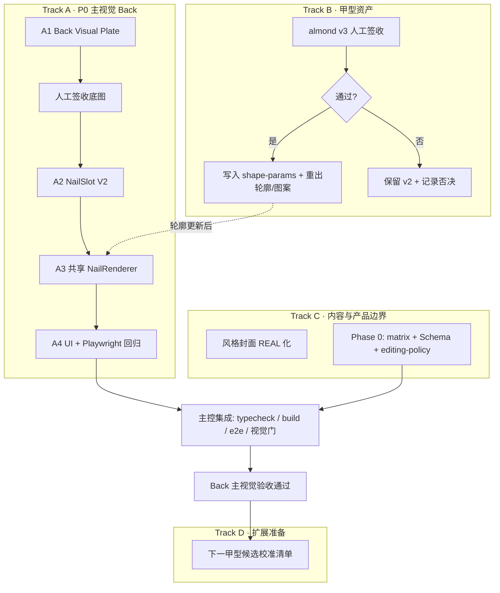

# 近两周开发计划 · 智能美甲 Studio

> **基准日期：** 2026-07-24  
> **当前基线：** DEV-PLAN v1.3.0 / Wizard MVP（almond 单甲型）可走通  
> **依据：** `项目进展与版本修订记录.md`、`DEV-PLAN.md`、`Studio模板库_产品备忘录与行动方案_2026-07-24.md`、主视觉修复 SubAgent 编排  
> **原则：** 先修「顾客是否相信这就是戴在手上」的主视觉事实，再扩甲型/组件化配方；并行轨道互不抢同一文件归属。

---

## 0. 现状一句话

应用侧（平台 / 客户 / 设备 / Wizard / Editor / 确认闭环）已可用；**主画布视觉仍不可信**（矢量手部插画 + `nailScale` 恒为常量），且 almond v3 / Phase 0 配方边界 / 风格封面仍未闭环。近两周目标是把 **Back 主视觉修到可签收**，同时并行推进资产与数据定稿，不解锁 Palm、不开放新甲型代码结构。

### 已完成（不再排期）

| 域 | 状态 |
|---|---|
| 登录/注册/Dashboard/客户/设备 | ✅ |
| Wizard 客户 → STEP1 门禁 → 风格推荐 → STEP2 三栏 | ✅ v1.3.0 |
| Editor MVP + 桥接 + 线下确认冻结 | ✅（进阶模式，不进首发验收主路径） |
| 甲型 v2 轮廓 24 + 模板图案 60 + 资产校验 | ✅ |
| e2e 13/13、typecheck、build | ✅ |

### 已知阻塞（必须进本计划）

| ID | 问题 | 影响 |
|---|---|---|
| V-01 | `hand-back.svg` 为扁平矢量插画 | 主视觉不像专业美甲工具 |
| V-02 | `nailScale()` ≡ `PX_PER_MM/10`，十指无法按甲床差异缩放 | 甲片像漂浮贴纸 |
| V-03 | Wizard `TenFingerPreview` 与 Editor `render.ts` 双路径 | 预览/编辑/导出不一致风险 |
| A-01 | almond v3 研究稿未人工签收 | 不能覆盖 v2 正式资产 |
| C-01 | 2/3 风格封面仍为 MOCK | 推荐弹窗可信度不足 |
| D-01 | Phase 0：matrix / Schema / editing-policy 缺失 | 组件化配方无法定稿 |

---

## 1. 北极星与两周成功标准

**北极星（首发收紧）：** 美甲师 3 分钟内从模板完成一份十指确认卡。

**本周期（约 7/24–8/7）唯一硬成功标准：**

> 在 Back 主画布中选 Almond + 14/18/22/26mm + Top 3 任一模板时：十甲贴合指尖（甲根对齐、方向正确、各指尺寸不同、换长度只向甲尖延长、图案不越界）；背景为真实感手部摄影板，不再像矢量插画。

附带完成：almond v3 签收结论（通过则升资产；不通过则保留 v2 并记录否决原因）、Phase 0 三件套定稿、至少 1 张 MOCK 风格封面升级为 REAL。

**本周期明确不做**

- Palm 底图/标定/开发
- 改 `nails-shape-svg` skill（除非 almond v3 已签收）
- 引入 WebGL / Three.js / 重型 CV
- 新甲型 UI 解锁（仅白名单加名，不改门禁结构）
- 自由手绘 / 任意上传进首发路径

---

## 2. 四条并行轨道（依赖关系）



**硬门禁**

1. A1 未人工签收 → 禁止 A2 标定  
2. A2 Slot 未稳定 → 禁止 A3/A4 改主画布布局  
3. almond v3 未签收 → 禁止覆盖 v2 正式轮廓 / 禁止动 skill  
4. Back 主视觉未过门 → 禁止开始 Palm、禁止扩甲型上线

**文件归属（与 SubAgent 对齐）**

| 轨道 | SubAgent | 允许改 | 禁止改 |
|---|---|---|---|
| A1 | `studio-back-visual-plate` | `assets/visual-plates/back/*` | React / Slot / 渲染 |
| A2 | `studio-nailslot-v2` | `slots.back.v2.json`、`tools/slot-calibrator/*` | 底图、业务 UI |
| A3 | `studio-nail-renderer` | `src/studio/render-core/*`、预览/编辑适配 | Slot 数值、底图、甲型几何 |
| A4 | `studio-visual-ui-qa` | Wizard/Editor 展示、Playwright | 矩阵算法、Slot 数值 |
| B | 主控 / 资产 | `shape-params`、silhouettes（仅签收后） | 主视觉投影逻辑 |
| C | 主控 / 产品 | `assets/styles/*`、Schema、policy、matrix | 渲染核心 |

---

## 3. 日程拆解（建议日历）

> Sprint 1 日历窗：7/27–8/7（DEV-PLAN）。下列按工作日拆包；可按人力压缩，但 **A 轨顺序不可颠倒**。

### Week 1 · 7/24–7/31 — 主视觉底座 + 签收闸门

| Day | Track A | Track B / C（可并行） | DoD |
|---|---|---|---|
| D0–D1 | **A1** 产出 ≥3 候选 Back 底图，提交 1 张最优 + manifest `pending_review` | **B** 组织 almond v3 视觉签收会（对照 `v3-almond-root-study.png`） | A1 停等人工；B 有签收结论（通过/否决） |
| D2 | **人工签收 A1**（通过才继续） | 若 B 通过：参数写入 `shape-params.json`，准备重出（仍不动 skill 直至批准确认） | 底图 acceptance ≠ pending |
| D3–D5 | **A2** 十指 Slot V2 + calibrator + 纯 TS 仿射/长度算法 + 单测 | **C2** 起草 `style-compatibility-matrix.json`（almond×4 长度 × Top 3 先填满） | `slots.back.v2.json` 可独立打开校验；matrix 草案可评审 |
| D5 | A2 自检：拇指≠四指、无 `PX_PER_MM` 落点、换长度甲根不动 | **C1** 至少替换 1 张 MOCK 封面为 REAL（优先猫眼） | A2 报告「未接入主画布」 |

### Week 2 · 8/1–8/7 — 共享渲染 + UI 回归 + Phase 0 收口

| Day | Track A | Track B / C | DoD |
|---|---|---|---|
| D6–D8 | **A3** `src/studio/render-core` + 适配 TenFingerPreview / Editor render / export-png；先纯色 Almond 四长度贴合，再叠模板 | 若 B 已签收：重出 almond 4 轮廓 + 相关图案 + validate PASS | 禁止双套落点逻辑并存；纯色十指贴合 |
| D9–D10 | **A4** Wizard 接入、选中态、dev Slot 辅助线、Playwright 截图（纯色×4 + 法式 + 花朵） | **C2** 四份 JSON Schema + `editing-policy.md` 定稿 | e2e/截图绿；Phase 0 三件套可评审 |
| D10 | **主控集成**：typecheck / build / e2e / PNG↔画布对比 / 视觉门清单 | 更新 `项目进展与版本修订记录.md` → 准备 DEV-PLAN v1.4.0 | Back 主视觉验收通过或明确缺口清单 |

---

## 4. 分轨道详细任务

### Track A · 主视觉 Back（P0）

**A1 Back Visual Plate**

- 输出：`assets/visual-plates/back/` + `manifest.json`（version、尺寸、view=back、背景色、acceptance）
- 约束：真实皮肤、十指甲床可见、无成品美甲、无矢量卡通
- 停点：人工签收

**A2 NailSlot V2**

- 输出：`assets/nail-slots/slots.back.v2.json`、`tools/slot-calibrator/*`、affine + 长度工具函数与测试
- 字段语义：`rootLeft/rootRight/tipCenter/nailBedWidthPx/visibleLengthPx/transform[6]`
- 废弃：用 `PX_PER_MM` / `fingerWidthMm` 推导主视觉落点；**禁止修补**旧 `nailScale`

**A3 共享 NailRenderer**

- 输出：`renderNail({ shape, length, fingerCode, slot, recipe, fingerOverrides, mode })`
- 层序：clip → 底色 → Recipe → attachment → outline/hit
- 适配：`TenFingerPreview.tsx`、`editor/lib/render.ts`、`export-png.ts`
- 验收：Wizard / Editor / PNG 同 design 甲片位置一致

**A4 UI + 回归**

- Wizard 主视觉优先（手+甲，非卡片墙）
- Palm：隐藏或标「未启用」
- Playwright：Almond 四长度纯色 + `t_french_white` + 一款花朵/浮雕模板
- 开发态 Slot 标定线开关（仅 dev）

**视觉门（主控亲自过）**

- 甲根 vs 甲床误差目标 ≤3px  
- 拇指/中指/小指宽度与旋转可区分且正确  
- 不漂浮、不穿指、不贴关节  
- 换长度甲根固定  
- 背景像摄影、不像矢量插画  
- 「能导出 PNG」≠ 通过

### Track B · almond v3

| 步骤 | 动作 | 红线 |
|---|---|---|
| 1 | 对照研究稿人工视觉签收 | 未签收不覆盖 v2 |
| 2a 通过 | 参数 → `shape-params.json` → skill → 重出 4 轮廓 + 相关图案 + Mock STL → `validate-assets.py` PASS | 版本记入进展记录 / DEV-PLAN |
| 2b 否决 | 保留 v2；写否决原因与下一轮假设 | 不改正式资产 |

与 A3 关系：轮廓替换是资产热切换；**不改变** affine 接口。若 v3 在 A3 中途落地，以「先贴合再叠图案」顺序回归一次即可。

### Track C · 内容与 Phase 0

1. **风格封面**：`liquid-velvet-cat-eye`、`sea-glass-mermaid` 从 `cover_status: MOCK` → `REAL`（至少完成 1，目标 2）  
2. **`style-compatibility-matrix.json`**：首周先 almond×长度×Top 3；再扩草稿到 12 有效组合  
3. **四份 Schema**：Template / Component / Recipe / Production Profile  
4. **`editing-policy.md`**：白名单参数范围、默认值、风险提示  

验收：能描述任一 Top 3 的十指设计与工艺限制；编辑边界与备忘录一致（无自由手绘进首发）。

### Track D · 扩展准备（验收后才开工）

- 候选下一甲型：squoval / coffin（曲线签收清单，不改 Wizard 门禁结构）  
- 开放条件：曲线签收 + 白名单加名（§5.10）  
- Palm：独立底图 + 独立 Slot；**禁止镜像 Back**

---

## 5. 每日/里程碑验收命令

```bash
npm run typecheck
npm run build
node tools/e2e-smoke.mjs <baseURL>   # 维持 ≥13/13；A4 后增加截图集
python3 tools/validate-assets.py     # 资产变更后必跑
python3 tools/v3-almond-root-study.py  # 仅 B 轨需要时
```

主控集成清单（A4 完成后）：

1. 工作树无第二套 Slot 算法 / 无双渲染落点  
2. typecheck + build  
3. Playwright 冒烟 + 新截图回归  
4. 人工 Back：十指 × 四长度 × ≥2 模板  
5. 导出 PNG 与画布逐项对比  
6. 更新进展记录；评估 DEV-PLAN → **v1.4.0**（主视觉 Back 落地）

---

## 6. 风险与缓解

| 风险 | 缓解 |
|---|---|
| 底图签收反复，阻塞 A2 | D1 多候选并行；签收标准写死在 A1 manifest |
| A3 与旧 Editor 路径纠缠 | 先抽 `render-core`，适配层只换调用；禁止复制几何 |
| v3 与主视觉抢回归带宽 | v3 未签收则冻结；签收后只回归 almond 资产，不改 Slot |
| Phase 0 文档拖慢视觉 | C 轨独立人力；不占用 A1–A4 关键路径 |
| 「好看底图」掩盖未贴合 | 视觉门强制纯色 Almond 先过，再允许谈封面/模板美感 |

---

## 7. 版本与文档预期

| 触发条件 | 文档动作 |
|---|---|
| almond v3 签收并入库 | 进展记录 + DEV-PLAN 资产小节（原计划 v1.2.2 语义并入） |
| Back 主视觉四段落地并通过门 | DEV-PLAN **v1.4.0** + 进展记录大节更新 |
| Phase 0 三件套合并 | DEV-PLAN §5.9 勾选 Phase 0 Done |
| 下一甲型白名单开放 | DEV-PLAN §5.10 + Wizard 门禁加名（结构不变） |

---

## 8. 立即下一步（今天可执行）

1. **启动 A1**：`Use the studio-back-visual-plate subagent` 产出候选底图（停等签收）  
2. **并行约 B**：人工打开 `assets/shape-calibration/v3-almond-root-study.png` 做 almond v3 签收决议  
3. **并行开 C2 草稿**：`style-compatibility-matrix.json` 仅 almond×Top 3  
4. **不要**启动 A2/A3/A4，直到 A1 签收
